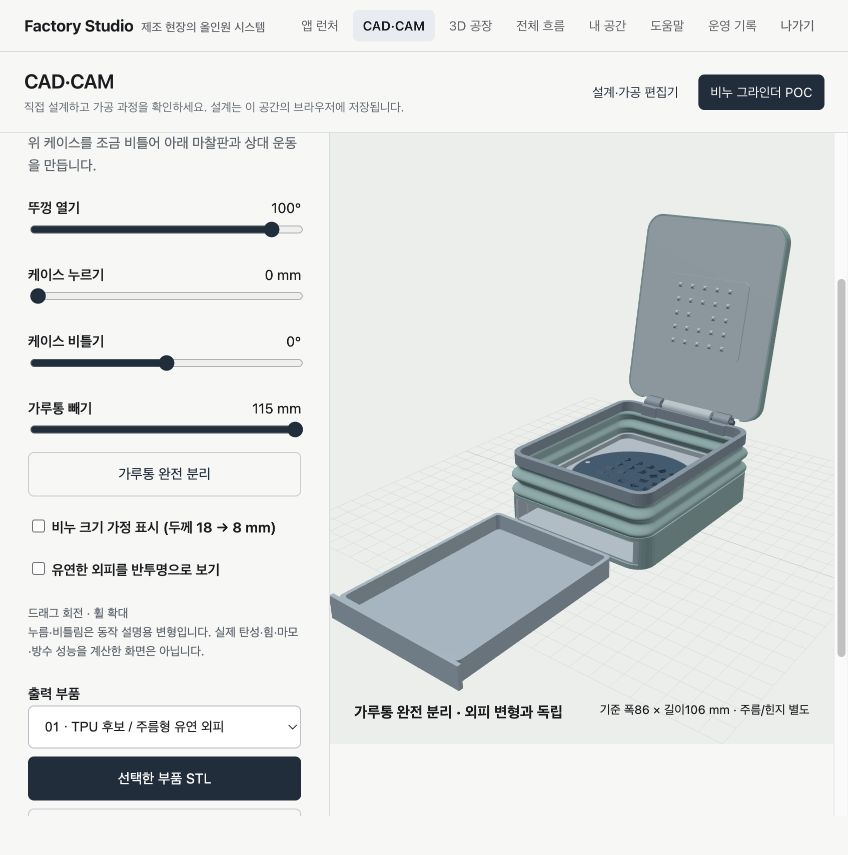

# CAD-03 관리자 비누 POC 결과

2026-10-06. 사용자 후속 요청으로 고무처럼 누를 수 있는 외피와 완전 분리 서랍을 반영했다. 최신 설계는 POC-03이다.

## 구현

일반 CAD/CAM 메뉴는 앱 런처 오른쪽에 유지한다. 비누 탭과 모든 관련 파일은 MEMBER+ADMIN만 접근한다. 정적 공개 자산에서 제거하고 기존 인증 의존성을 사용하는 API로 제공한다. 권한은 각 요청마다 검사하며 성공 응답은 private/no-store다.

외피·상부 커버·하단 스킨은 TPU 출력 후보, 내부 마찰판·서랍 가이드는 강체로 분리했다. 상부를 누르고 조금 비틀면 하부 고정 마찰판과 상대 운동한다. 가루통은 115mm 이동하여 완전히 빠진다. 총 9부품 STL과 생성 소스/설계 안내 ZIP을 관리자 화면에서 받는다.

## 검증 결과

- frontend Vitest 63파일/524테스트 통과. prototype 형상/CAM/STL 27테스트 통과.
- API 13테스트 통과: 비로그인401, 게스트/일반 회원403, 관리자200, 권한 회수·경로 이탈 차단. 테스트는 합성 AuthContext이며 실제 DB 세션 연동 시험은 아니다.
- 9개 단일 연결 폐곡면·양의 체적, 42개 강체 간섭 표본 통과. 탄성체 자체 접촉 검사는 제외한다.
- frontend 타입 검사/빌드 및 공개·보호 자산 분리 검사 통과. Three/공장 번들 크기 경고 있음.
- 실제 브라우저에서 관리자 9부품 로드, 누름10mm·비틀림12°, 힌지, 서랍 완전 분리, 보호 STL/ZIP 다운로드 확인. 게스트 탭/내부 링크 숨김 확인.
- DB 스키마 변경 없음. DB 검증 명령·실제 출력·슬라이서·물성/힘/마모/방수 시험 미실행.

## 남은 제약

재료 경도와 외피 결합/고정, 힌지 핀 이탈 방지, 서랍 걸쇠는 확정 전이다. 화면 변형은 기구 설명이며 유한요소 해석이나 실제 비누 분쇄 해석이 아니다. CAD/CAM 편집기는 기존 2.5D 포켓 가공 범위를 유지한다. 운영 배포·원격 push는 하지 않았다.

다음은 사용자 설계 검토 후 재료·결합을 확정하고 FDM 시험을 진행한다. 상세 치수와 시험 계획은 prototypes/cad-cam/private/soap-poc/DESIGN-v3.md를 참조한다.

