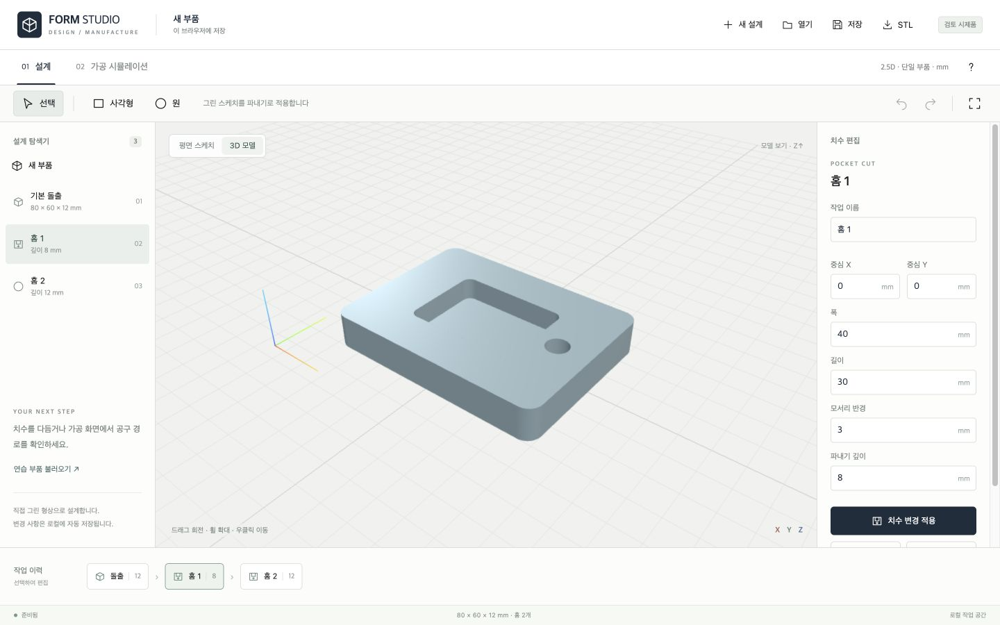
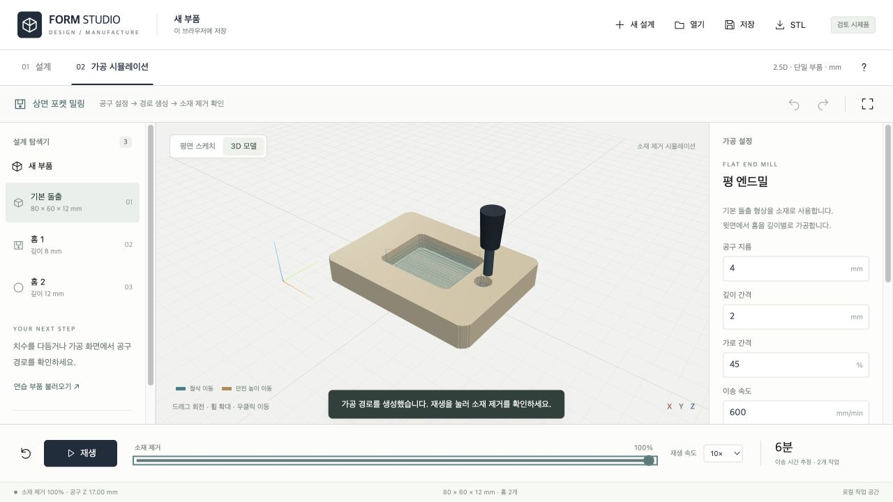

# CAD-01 직접 설계하는 웹 CAD·CAM 편집기

작업: 2026-10-04~05, Codex. CAD-01 독립 검토 시제품. 운영 제품 배포가 아니다.

## 사용자 의도와 범위

사용자는 PDF 제품의 모델을 대신 만들어 달라는 것이 아니라, 자신이 직접 스케치·치수 편집·3D 설계를 하고 가공 시뮬레이션까지 실행할 수 있는 웹 프로그램을 요청했다. CAD-00에서 제시한 기구 선택 질문은 철회했다. 비누 그라인더는 사용자가 설계할 대상이며 프로그램은 특정 제품 구조에 종속되지 않는다.

제품 코드·DB를 변경하지 않는 독립 검토 시제품으로 `prototypes/cad-cam/`에 구현했다. ROADMAP-02의 전체 설계 우선 상태를 유지하며 포털의 새 솔루션 등록·운영 게시·원격 push를 하지 않았다.

## 구현한 사용자 흐름

1. 빈 설계에서 사각형/원을 드래그하거나 치수를 입력한다. 1mm 드래그 스냅, 숫자 입력 시 스케치 미리보기.
2. 첫 스케치를 돌출해 단일 기본 부품을 만든다. 사각형의 평면 모서리 반경을 조절할 수 있다.
3. 추가 스케치를 상면 파내기로 적용한다. 서로 겹치는 홈·다른 깊이·관통 구멍을 지원한다.
4. 탐색기/작업 이력/3D 선택에서 치수 수정·복제·삭제를 한다. 실행 취소·다시 실행은 세션 내 50단계다.
5. 브라우저 로컬 자동 저장, JSON 파일 저장/열기, mm 기준 STL 메시 내보내기를 사용한다.
6. 공구 지름·깊이 간격·가로 간격·이송·안전 높이로 2.5D 경로를 계산한다. 과대 공구는 거부하고 공구보다 작은 안쪽 모서리의 잔삭을 안내한다.
7. 재생/정지/속도/진행률 이동/처음으로를 통해 공구 이동과 실제 높이장 소재 제거를 확인한다. 제거 부피와 남은 절삭량은 격자 근사로 표시한다. 설계나 공구 설정이 바뀌면 이전 경로를 무효화한다.

## 구조와 제약

- Three.js + polygon-clipping. 깊이별 단면 차집합으로 표면을 생성한다. B-Rep 커널 기반 정밀 CAD가 아니며 곡선은 폴리곤 근사다.
- 소재 제거는 worker에서 평 엔드밀 원통의 쓸림으로 격자 기둥 높이를 줄인다. 되감기는 원소재로부터 다시 계산한다. 오래된 요청 결과는 버전으로 배제한다.
- 기본 돌출 외곽이 준비된 소재의 상면 포켓 가공이다. 원소재에서 외곽 전체를 깎는 CAM이 아니다.
- 단일 기본 돌출 + 최대 32개 홈, 최대 200×200×80mm. 홈은 외곽 안에 최소 0.1mm 벽을 남긴다.
- 소재 격자 기준 크기 `max(0.4, 폭/150, 길이/150)`mm, 화면에 실제 셀 크기를 표시한다. 작은 홈/원호/경계에는 근사 오차가 있다.
- 자유 곡선·보스 추가·임의 면 스케치·구속 솔버·조립·STEP·다축·금형·기계용 NC 출력은 미지원이다.
- 실제 절삭량/재질/토크/공구 날 길이/홀더·고정구·장비 충돌/방수는 검증하지 않는다. 이송 시간은 가감속·공구 교환을 제외한 추정이다.
- 서버 API·원격 저장·외부 폰트 요청 없음. 원본 PDF와 개인·사업 정보는 포함하지 않았다. 예제는 합성 부품이다.

## 검증

### 자동 검사

`cd prototypes/cad-cam && npm test`: 9개 통과.

최종 `npm run build`와 `npm run format:check`도 통과했다. 빌드는 메인 JS 627.94KB(gzip 164.42KB)에 대한 500KB 청크 크기 경고가 있으며, 오류는 아니다. 후속 성능 최적화 대상으로 남긴다.

- JSON 편집 파라미터 왕복 및 NaN/무한대/범위/중복 ID/파일 크기 거부.
- 원·둥근 사각형 경계점과 거리 함수 일치.
- 깊이가 다른 중첩 포켓의 해석적 부피와 메시 부피 일치.
- 관통 구멍의 부피와 바닥 제거.
- 공구 중심의 포켓 내부 유지 및 급속 XY 이동의 안전 높이.
- 과대 공구 거부, 날카로운 내부 모서리 잔삭 안내.
- 점진적 소재 제거·외벽 보존·잔삭 계산.
- 실제 worker의 순차 재생/되감기와 전체 재계산 결과 일치.

### 실제 브라우저

Codex 내장 브라우저에서 직접 조작했다.

- 빈 설계 → 80×60×12mm, 모서리 R5 기본 돌출 생성.
- 40×30mm/R3/깊이8 사각 홈, X28/지름8/깊이12 관통 구멍 추가.
- 작업면에서 사각형 드래그(10×7mm)와 원 드래그(지름8mm) → 파내기 적용.
- 숫자 입력으로 폭 35.2mm 변경 시 스케치 미리보기 반영.
- 실행 취소/다시 실행으로 홈 수 3→2→3 확인.
- 4mm 공구 경로 생성, 재생/정지, 진행률 100%, 처음으로 복원.
- 위 부품의 완료 제거 부피 10.09cm³, 남은 절삭량 0.21cm³, 되감기 후 0.00cm³. 이는 0.53mm 격자의 근삿값이다.
- 공구 지름을 10mm로 바꾸면 재생 비활성화. 지름8 홈에 대한 과대 공구 오류 표시.
- JSON 실제 다운로드 후 열기 버튼으로 재입력, 치수/홈 복원 확인.
- STL 실제 다운로드, 바이너리 길이/삼각형 수 검사: 78,884바이트, 1,576삼각형.
- 1440×900 및 390×844 화면에서 가로 넘침 없음. 좁은 화면은 작업면 아래 속성 패널로 배치한다. 실기기 시험은 아니다.
- 브라우저 오류 로그 0. 내장 브라우저의 다운로드 이벤트 대기 기능은 응답하지 않아 실제 다운로드 파일로 확인했다.

확인 중 수정: HTML number step 불일치, SVG hidden 처리, 공구 입력 즉시 경로 무효화, 속성 패널 스크롤 위치, 좁은 화면 배치, 스케치 치수 입력 미리보기.

### 미실행

Safari·실제 모바일·운영 서버·실물 가공·외부 CAD/슬라이서 호환 검증. DB 변경이 없어 `db:validate`, `db:build`, `build_erd.py`는 실행하지 않았다.

## 재현과 다음 작업

```sh
cd prototypes/cad-cam
npm ci
npm run dev
# http://127.0.0.1:5241/
npm test
npm run build
npm run format:check
```

실행 중인 5241 서버가 있으면 중복 실행하지 않는다. 빌드 산출물은 `dist/`이며 Git에서 제외한다. Node 26.7.0에서 검증했다.

다음은 사용자 체험 확인 후 후속 범위를 정한다. 정밀 CAD 커널, 자유 스케치, 복수 부품/조립, 실제 포털 연결은 자동 착수하지 않는다.




