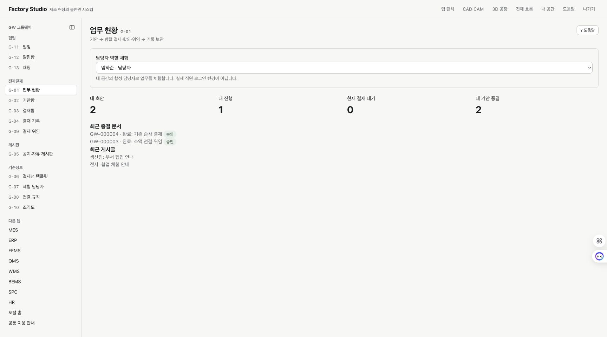
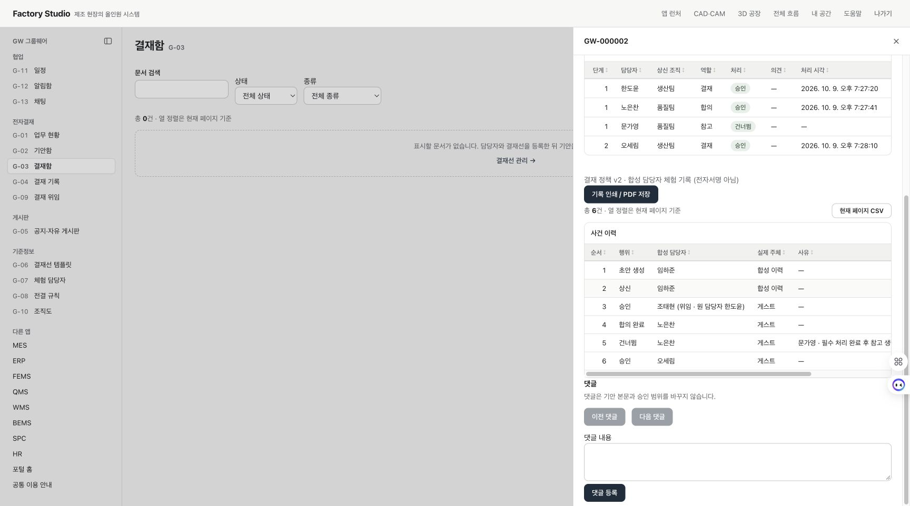
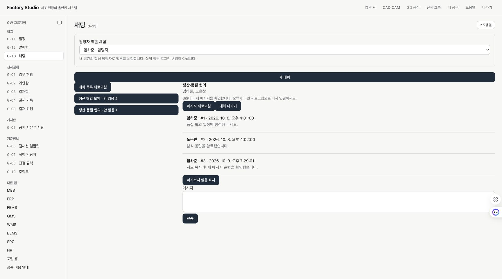

# GW-e 시드·도움말 개발 결과

2026-10-09 · codex/gw-dsn31 · 시작8216636 · WIP d78e534 · 완료(최종 커밋은 git log -1).

GW 체험을 빈 화면부터 설정하지 않아도 조직·결재·협업까지 이어서 실행할 수 있도록 GW 19개 표에 98행 합성 데이터를 추가했습니다. 새 시드 버전은 `sv-20261009-gw1`입니다. 현재 DB schema0.21.0/headgw_a_dsn31/GW19·전체173표는 변경하지 않았습니다.

## 변경

- HR의 합성 부서4·사원10 코드를 사용한 조직·담당자 스냅샷. 일반/ERP 매입 초안, 병렬·합의 대기, 전결·위임 완료, 기존 v1 순차 완료 이력. ERP 원문은 공개 조회 인터페이스의 실제 snapshot·digest를 사용합니다.
- 전체/부서 공지, 수정 댓글과 삭제 표시, 개인/부서 일정·응답·취소, 읽음/미읽음 알림, 1:1/그룹 대화·보관 메시지·읽음커서·나간 참여자.
- 복사 시 FK 밖에 있던 결재 JSON의 stepId/delegationId/전결ID·범위/월/시각, 알림 refId/eventKey를 새 세대로 변환합니다. 상신 적용월은 이동한 KST 상신 시각으로 재계산합니다. 코드·이름·금액·원문digest와 채팅 seq/clientKey/readCursor는 보존합니다. 같은 트랜잭션의 여러 복사도 지원합니다.
- SQL NULL과 JSON null을 구분하고 GW 사건 시각을 보존합니다. 예정 일정과 위임 종료일만 미래 날짜를 허용하며 기록 시각 검사는 유지합니다. V-GW가 실제 참조·댓글 이력·종일 일정·메시지 순번·읽음범위를 검사합니다.
- G-01 체험 순서와 공통 안내, G-01~13 도움말 완비. 정적 흐름맵에 HR→GW 조직→결재→협업 추가. DSN-90에 실제 제공 계약과 외부 미구현 경계를 기록했습니다.

## 검증

- 실제 PostgreSQL 신규6 통과: 새해/윤년 복사·원본 불변·참조/날짜 변환, 기존공간 새세대 및 유데이터 정리, 초기화 후 GW만 1회 지연복사, 위임승인→합의→종결, 복사후 메시지 재전송/추가seq, 월초 템플릿의 전월 상신.
- 전체 백엔드: 최초 실행974통과/1실패/1건너뜀(379.71초). 새 게스트 GW가 비었다고 가정하던 조직격리 테스트1건을 시드10명4부서·ID격리·타공간담당자404 확인으로 보정했습니다. 해당 조직파일17개가 최종 재실행에서 모두 통과(37.85초)하여 총975개 서로 다른 테스트의 통과를 확인했습니다. 보정 후 전체를 다시 실행한 수치는 아닙니다.
- 전체 프런트엔드566통과/71파일, 타입·전체ESLint·Vite빌드 통과. 변경 Ruff/format·diff 검사 통과. DB설계/격리173표412FK 오류0. 기존 test_gw_policy.py import 정렬1건도 보정하여 root 전체 백엔드 Ruff를 통과했습니다.
- Chrome 새guest11/gen13: GW최초개방·담당자10, 기안자 초안2/진행1/종결2, 실제대리승인→품질합의→임원최종승인, 새알림 및 복사알림→부서일정응답, 채팅 기존seq1/2→새seq3, 390px 가로넘침0, 댓글수정이력·삭제표시, G01도움말/전체흐름. 브라우저 처리 후 V-GW도 통과.

## 재현

독립 `_test` DB의 접속값을 환경변수에 넣고 저장소 루트에서 실행합니다. main의 venv를 재사용하면 `PYTHONPATH="$PWD/backend/src:$PWD/backend"`를 지정해야 이 worktree 코드를 실행합니다. 같은 DB에 독립 pytest를 동시에 실행하지 않습니다.

```sh
PYTHONPATH="$PWD/backend/src:$PWD/backend" TEST_DATABASE_URL="$GW_TEST_DATABASE_URL" python -m pytest backend/tests -q -m 'not perf' -n 4
PYTHONPATH="$PWD/backend/src:$PWD/backend" TEST_DATABASE_URL="$GW_TEST_DATABASE_URL" python -m pytest backend/tests/test_gw_seed.py -q
npm --prefix frontend test
npm --prefix frontend run build
npm --prefix frontend run lint
python tools/validate_db_design.py
python tools/audit_schema_isolation.py --schema docs/db/schema-metadata/schema.json
```

## 적용 범위와 다음 작업

격리 worktree와 전용 테스트 DB에서만 작업했습니다. 공유 개발/운영 DB·main 변경, push·merge·배포는 수행하지 않았습니다. 새 시드를 적용하려면 배포 단계에서 새 템플릿을 생성해야 합니다. 기존 운영 템플릿을 수정하지 않습니다.

GW-a~e 체험 범위는 구현했습니다. 다음은 현재 main과의 병합 검토 및 사용자 검토입니다. ERP F44와 신규 발주/지출결의·PLM ECO 원천 제공은 각 솔루션 후속 단계, 실제회사 TEAM/계정 권한은 별도 도입 범위입니다. 네이티브 인쇄 미리보기/PDF와 대량 운영 부하는 미검증입니다.




