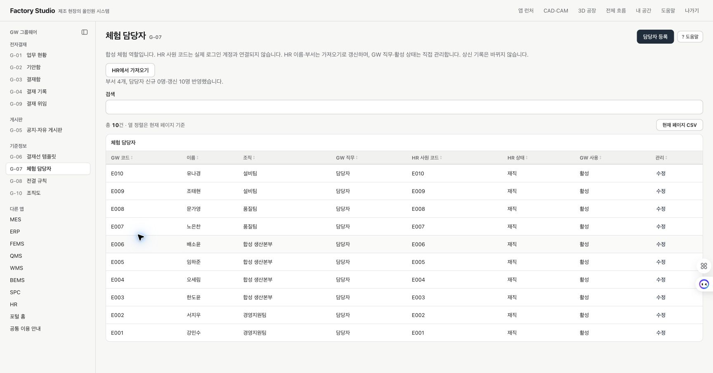
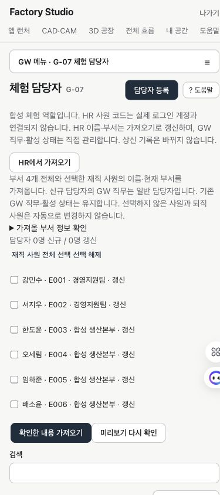

# GW-c 조직·HR 연계 개발 결과

2026-10-09 · `codex/gw-dsn31` · 시작 `0dd6ef9` · WIP `1fe0642` · 최종 커밋은 `git log -1 --oneline`.

사용자 “다음 진행해줘 / 이어서 진행해줘”에 따라 DSN-31 GW-F21~23, G-07·G-10을 구현했다. 별도 worktree·합성 데이터·독립 PostgreSQL 테스트 DB를 사용했다.

## 구현

- **G-07 체험 담당자**를 공통 `MasterScreen`으로 전환했다. 검색·등록·부분 수정·버전 검사·비활성화 정책을 유지하고 조직·HR 사원 코드·현재 HR 상태를 표시한다. 삭제 버튼은 제공하지 않는다. HR 연결 이름은 가져오기로만 갱신한다.
- **HR에서 가져오기**: HR `employees(status=None)`·`departments()`를 읽고 부서 정보와 선택한 재직 사원을 검토한 뒤 명시적으로 저장한다. 부서는 전체, 사원은 선택한 대상만 반영하며 부서만 가져오기도 가능하다. 한 요청의 사원 선택은 최대1,000명이다.
- **재가져오기**: HR 사원 코드로 기존 담당자를 찾아 같은 ID에 이름·현재 조직을 갱신한다. 신규 GW 직무는 STAFF. 기존 GW 직무·활성 상태를 유지하고 퇴직·휴직·선택하지 않은 사원을 자동 비활성화하지 않는다. HR 원천에서 없어져도 과거 참조를 삭제하지 않는다.
- **G-10 조직도**: 현재 HR 계층과 마지막 가져온 GW 조직을 전환해 읽기 전용으로 확인한다. 코드·부서명·상위 코드·사용 상태·HR 부서장 코드·가져온 시각(KST)을 표시한다. HR 조회 불가에서는 마지막 조직과 조회 불가 안내를 보여 준다.
- **상신 조직 보존**: HR 발령·부서명 변경 후 현재 담당자 조직을 갱신해도 이미 상신한 기안자·결재자 조직 스냅샷과 결재 이력은 변하지 않는다. 결재 상세에도 기안 조직·참여자 상신 조직을 표시한다.
- **방어 규칙**: 미리보기 이후 HR/GW 변경은 digest 재검사로409 거부한다. 순환·누락된 상위·활성 부서의 비활성 상위·중복 연결·코드 충돌은 거부하며 전체 쓰기를 롤백한다. 같은 GW 코드의 수동 담당자를 임의로 HR에 연결하지 않는다. GW 코드 형식에 맞지 않는 HR 코드는 결정적 HR 접두 코드로 저장하고 원래 사원 코드를 보존한다.
- **공통 엔진**: 공간 잠금·세대 재검사·CSRF·멱등 영수증·감사를 사용한다. 가져오기 감사와 영수증은 공간 단위에 기록한다. 같은 요청 재전송은 중복 기록 없이 기존 결과를 반환한다. HR에는 쓰지 않고 업무 간 FK도 추가하지 않았다.
- 역할 선택 전용 전체 조회를 추가해 담당자100명 이후도 선택할 수 있다. 일반 담당자 목록은 기존 페이지 제한을 유지한다. bigint ID는 문자열로 유지한다.
- G-07·G-10 도움말을 추가했다. 공통 마스터에 검색·외부 목록 갱신·저장 후 후속 갱신·삭제 숨김 옵션을 추가했고 기존 화면의 기본 동작은 유지했다.

## 검증

| 항목 | 결과 |
|---|---|
| 전체 backend, `not perf`, xdist4 | **944 passed, 1 skipped**, 362.48초 |
| 마지막 GW 전체 집중 | **66 passed**, 107.36초; GW-c17개 포함 |
| 마지막 가져오기 감사 보정 후 GW-c | **17 passed**, 46.13초 |
| 전체 frontend | **559 passed /70파일**, 38.52초 |
| 마지막 GW·MES 기준정보·공통·포털 집중 | **134 passed /16파일**, 8.30초 |
| TypeScript·전체 frontend ESLint·최종 build | 통과 |
| GW backend·신규 테스트 Ruff check/format | 통과 |
| 메타데이터/격리 `db:validate` | 오류0 |
| Chrome 실제 API | HR 미개방 안내 → HR 개방 → 부서4·사원10 신규 가져오기 → HR 부서명 변경 → 현재 HR/GW 스냅샷 비교 → 신규0·갱신10 재가져오기 |
| Chrome390px | 담당자·가져오기·조직도 본문 가로 넘침0, 표는 내부 스크롤; 도움말 본문 연결 확인 |

신규 DB 검증은 HR 실제 발령 API를 이용한 부서 이동·퇴직 상태 표시, 상신 조직 불변·이후 승인, HR 꺼짐/빈 HR 구분, 공간 격리·CSRF, 멱등·동시 가져오기, 전체 롤백, 원천 변경, 잘못된 계층, 코드 변환, 부분 수정 버전,101명 역할 조회를 포함한다. 프런트는 확인 전 쓰기 없음·선택한 사원/digest 전송·HR 꺼짐의 마지막 조직·읽기 전용 조직 전환·버전 수정·삭제 숨김·깊은 계층/순환 검사를 확인했다.

전체 프런트 재실행에서 기존 MES 진입 테스트가 대시보드 응답을 빈 배열로 모의해 `pipeline.map` 오류를 낸 것을 확인했다. `frontend/src/mes/master.test.tsx`에 정상 형태의 합성 대시보드 응답만 추가한 뒤 전체559개가 통과했다. MES 제품 코드는 변경하지 않았다.

전체 Ruff를 저장소 루트에서 실행하면 기존 `test_gw.py`·`test_gw_policy.py`의 import 정렬2건이 남는다. 두 파일은 시작 커밋과 같으며 신규/변경 GW 제품 코드와 신규 테스트의 Ruff는 통과했다. Python 사용중단·시드 복사 경고와 번들 크기 경고는 유지된다. 과거 GW-b 인쇄 미리보기/PDF 미검증도 이번에 해소한 것은 아니다.

## 실행 조건·한계

DB/schema/마이그레이션/시드 버전은 GW-a 상태를 유지한다(schema0.21.0/headgw_a_dsn31, GW19·전체173표). 기존 공간에 자동 HR 동기화를 적용하지 않는다. 가져오기는 합성 체험 담당자 연결이며 실제 인증 주체·권한·TEAM 공유 공간은 별도 실제 도입 트랙이다. 운영 DB 적용·원격push·배포는 수행하지 않았다.

브라우저에서는 현재 HR 조직/스냅샷·명칭 변경/재가져오기·모바일·도움말을 확인했다. 하위 부서 계층·실제 발령 후 상신 조직 불변은 DB/API·프런트 검증으로 확인했으며 브라우저에서 발령 결재를 재연하지는 않았다.

## 재현

작업 폴더는 `/Users/hwang-kyoungho/Documents/Codex/2026-10-09/gw/work/factory-studio-gw`이며 아래 명령은 이 저장소 루트 기준이다. `TEST_DATABASE_URL`을 독립 `_test` DB로 제공하고 현재 worktree 코드가 선택되도록 `PYTHONPATH=backend/src:backend`를 설정한다. 동일 DB에 독립 pytest 프로세스를 동시에 실행하지 않는다. 기존 main venv와 Node24를 사용할 수 있다.

```sh
python -m pytest backend/tests -q -m 'not perf' -n 4
python -m pytest backend/tests/test_gw.py backend/tests/test_gw_policy.py backend/tests/test_gw_organization.py -q
npm --prefix frontend test -- --maxWorkers=2
npm --prefix frontend run build
ruff check --config backend/pyproject.toml backend/src/fs/gw backend/tests/test_gw_organization.py
ruff format --check --config backend/pyproject.toml backend/src/fs/gw backend/tests/test_gw_organization.py
npm run db:validate
```

브라우저는 독립 API8073·Vite5273, `COOKIE_SECURE=false`·합성 SESSION_SECRET을 사용했다. 로컬 인증 쿠키 충돌을 줄이기 위해 최종 확인은127.0.0.1 주소에서 했다. 검증용 서버·탭·임시 viewport는 종료/복원했다. 의존성 symlink와 접속값은 Git에 포함하지 않았다.

## 다음 단계

사용자 확인 후 **GW-d 협업**: G-05 댓글·G-11 일정·G-12 알림함·G-13 채팅. 이후 GW-e 시드·도움말·통합 확인. GW-d는 이번 단계에서 시작하지 않았다. ERP 확정 통제는 ERP 담당자 소유이며 발주/경비·PLM ECO 제공 구현은 GW-b의 외부 의존으로 유지된다. EIP 공지/공통 조회 계약도 후속 협업 단계에서 실제 제공 상태를 재대조한다.




