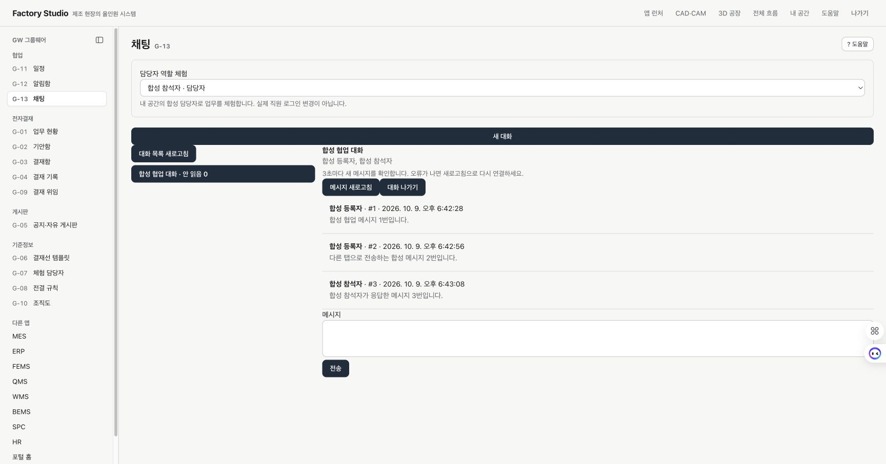
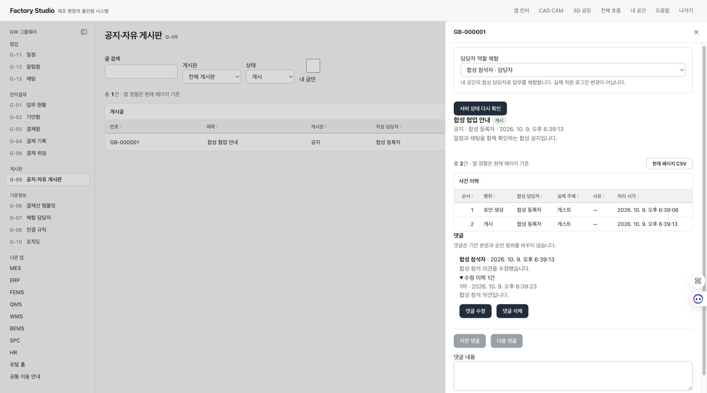
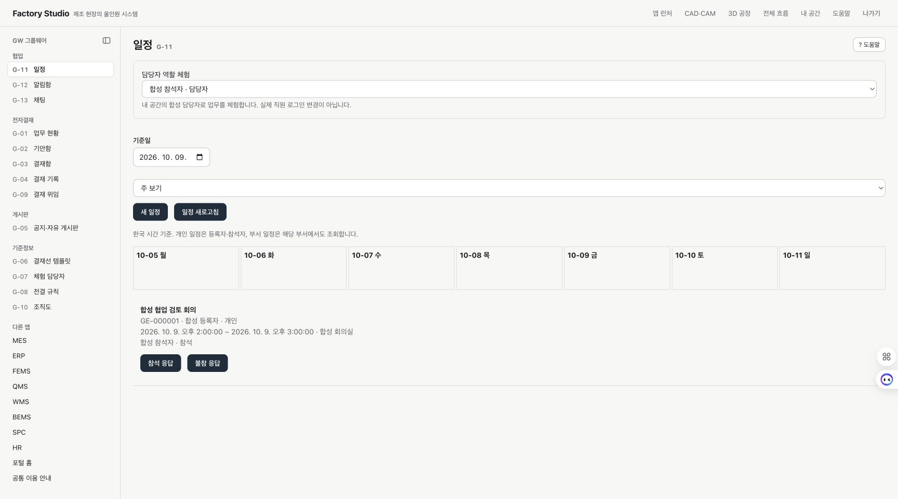

# GW-d 댓글·일정·알림·채팅 개발 결과

작성: 2026-10-09 · 브랜치 `codex/gw-dsn31` · 기준 `b39e274` · WIP `2a30415` · 최종 커밋은 `git log -1 --oneline`.

## 완료 범위

DSN-31의 GW-F12·13·31·32·33·43, G-04/05 보강·G-11/12/13을 구현했다. 실제 회사 TEAM/계정 ACL·ERP 확정 통제는 별도 담당/트랙 그대로다. 스키마·마이그레이션·시드 버전은 변경하지 않았다(schema0.21.0/GW19·전체173/headgw_a_dsn31).

- 댓글: 게시글·결재 문서 대상, 본문/결재 버전 불변. 작성자만 변경, 수정 전 revision 추가, 삭제 표시/내용 숨김. 이력·댓글에 대상 열람 판정, 50개 페이지. 댓글 등록 알림은 원문 작성자에게 같은 TX로 저장.
- 부서 공지: NOTICE만 ORG, HR에서 가져온 활성 GW 조직 선택. 작성자·현재 소속만 목록/상세/댓글 조회, 이동 후 이전 부서 제목·본문·알림 숨김. 게시 후 불변/정정/철회 유지. 비활성 부서의 과거 공지도 철회 가능.
- 일정: 한국 시간 월/주 보기, 기간 겹침 `[start,end)`, 개인/부서·참석자 최대100, 등록자 편집/취소·참석자 응답. 부서 ID 생성 때 고정, 동일 부서 범위 편집 때 HR 이동으로 자동 재배정 없음. 종일은 한국 자정 경계, 취소 기록 보존, 수정 시 참석 응답 재수집.
- 알림함: 결재 도착/완료/반려/회수·공지·댓글·일정. 업무 변경과 같은 TX에 `(recipient,event_key)` 1건. 조회 페이지 이전에 현재 열람 필터, 최초 읽음 시각 보존. 상신/단계 전환 당시 유효한 대리 담당자 포함; 이후 추가 위임은 결재함에서 확인.
- 채팅: 1:1/그룹2~100, 고정 명단, 추가만 하는 일반 텍스트. 대화방 잠금→순번 증가, `(channel,author,clientKey)` 재전송 중복0·다른 내용 거부. 나간 후 메시지 조회/전송 차단, 수동 단조 읽음 커서. HTTP 저장·활성 화면3초 조회, 순번/100건 단위 재연결, 오류 때 수동 재조회. WebSocket/SSE·첨부·참여자 추가/재입장 제외.
- 공통 제공: 전체 공간 `published_notices(limit)`·KST 상신월 `monthly_summary`·HR 사원 코드 기반 본인/위임 `pending_tasks`·문서/전체 공지 `lookup`. GW off=None, 빈 데이터와 구분. EIP는 선택 역할이 없으므로 부서 공지를 제공하지 않음. 제공 측에서 타 솔루션 조회 안 함.
- 공통 엔진: optional `authorize` callback을 공간 잠금 뒤/멱등 영수증 조회 전에 실행. 다른 기존 호출은 기본 None 유지. 채팅 탈퇴·공지 조직 이동 뒤 이전 요청의 캐시도 내용 반환을 차단한다. 나가기 확인은 멱등 재시도 가능.
- 사용자 보호: 미저장 댓글/일정/메시지·역할 변경 보호, 쓰기 중 역할 차단. 삭제/취소/나가기는 화면 내 확인 버튼. 일반 브라우저 confirm 창 대신 명확한 확인·유지 흐름.

## 검증 결과

- 전체 backend: **967 passed, 1 skipped**, 362.24초. PostgreSQL 독립 작업자4DB. 최종 권한 재검사/회귀 추가 이전 전체 결과다.
- 최종 backend: **103 passed, 220.58초**, 공통+GW 전체(신규 협업23 포함). 탈퇴 후 멱등 캐시 접근 차단·공지 이동 후 읽음 캐시 차단 포함.
- 전체 frontend: **566 passed /71파일**, 15.18초. 신규 협업7개. 기존 GW-b 결재 UI mock에 신규 댓글 빈 응답을 보완했다. 제품 결재 동작은 유지.
- 최종 TypeScript/전체 ESLint/Vite build·변경 Ruff check/format·`git diff --check` 통과. DB 설계/격리 R1~R6 오류0(173표/412FK). 전체 root Ruff의 기존 GW 테스트 import2건은 이전 단계와 동일, 범위 검사 통과.
- Chrome 실제 API: 합성 등록자/참석자 등록→일정 생성→14~15시 수정→주간 보기→상대 참석 응답; 알림 읽음/원문 이동; 공지 게시→상대 댓글→수정 전 이력→삭제 표시; 1:1 생성→두 탭 메시지 자동 수신/응답 #1~3→읽음→모바일 나가기/목록 제거. 390px 일정/알림/채팅 본문 가로 넘침0, 채팅 도움말/화면 왕복 링크 확인.
- 브라우저 자동화 datetime-local fill이 React 변경을 보내지 않아 기본09~10시로 처음 저장됐다. 실제 키보드 변경 이벤트로14~15시 수정/표시까지 확인했다. 제품 단위 테스트도 KST09시→UTC00시 payload 검증.
- Mac 잠금 상태의 브라우저 native confirm 제어가 지연됐다. 화면 내 확인 UI로 바꾸고 다른 검증 탭에서 댓글 삭제·채팅 나가기 완료. 별도 네이티브 인쇄 미리보기/PDF(GW-b)는 계속 미검증. 대량 실시간 부하·실제 회사 권한·운영 배포 미검증.

## 화면 증거





390px: [채팅](assets/gw-d/chat-mobile.png), [일정](assets/gw-d/calendar-mobile.png), [알림](assets/gw-d/notifications-mobile.png), [삭제 표시](assets/gw-d/comments-deleted-mobile.png).

## 재현과 후속

독립 PostgreSQL `_test` DB에 migration head `gw_a_dsn31` 적용 후 `TEST_DATABASE_URL`을 환경으로 주입한다. 비밀값은 문서/명령 이력/Git에 기록하지 않는다. 현재 작업 폴더에서:

```sh
PYTHONPATH=backend/src:backend backend/.venv/bin/pytest backend/tests -n 4 -q --tb=short
PYTHONPATH=backend/src:backend backend/.venv/bin/pytest backend/tests/test_common.py backend/tests/test_gw*.py -q --tb=short
npm --prefix frontend test
npm --prefix frontend run build
npm --prefix frontend run lint
backend/.venv/bin/ruff check --config backend/pyproject.toml backend/src/fs/common/engine.py backend/src/fs/gw backend/tests/test_gw_collaboration.py
backend/.venv/bin/ruff format --check backend/src/fs/common/engine.py backend/src/fs/gw backend/tests/test_gw_collaboration.py
python3 tools/validate_db_design.py
python3 tools/audit_schema_isolation.py
```

venv/Node24 의존성은 재사용 가능, `PYTHONPATH`는 반드시 현재 worktree. 동일 DB에서 독립 pytest 여러 개를 동시에 실행하지 않는다. 전체 `-n4`는 작업자 DB를 복제하므로 초기 복제 동안 원본 DB preview 연결 금지. 검증용 서버8073/5273은 종료했다. 공유 main/개발 DB·운영·push·merge·배포 없음.

다음 **GW-e 시드·도움말·통합 검증**은 사용자 결과 확인 후 시작한다. 이번 단계는 데이터가 없는 기존 공간에서도 직접 등록·실사용 흐름이 동작한다. GW-e에서 전결/위임/조직·협업 유데이터 세대 복사/날짜 이동/내부ID 및 알림 event_key/clientKey 일관성·정리, 체험 시드/공통 도움말 등록과 DSN-90 계약 재대조를 수행한다. ERP/PLM 신규 원천 미제공·ERP F44 외부 소유는 유지한다.
