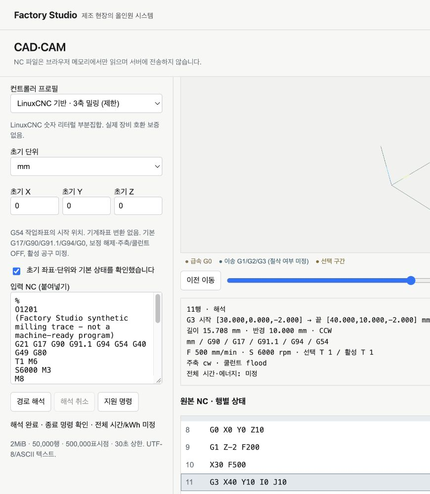

# CAD-12 NC 해석·3D 경로 검토 검증

2026-10-07 · 구현100% · 운영 배포 없음

사용자 ‘다음 단계 진행’ 승인으로 CAD-12 하나만 구현했다. 3축 밀링/G-code 우선, 선반 후속은 유지한다. [설계 계약](../modules/cad-cam/NC해석_경로검토_설계_CAD-12.md). 작업 시작7861ed1, WIP24779cd. 최종 구현/문서 커밋은 git log와 인계 기록 참조.

## 결과와 범위

포털 CAD·CAM에 ‘NC 경로 검토’ 메뉴(`/cad-cam?view=nc`)를 추가했다. `.nc/.ngc/.tap/.gcode/.cnc/.txt` 텍스트를 File API로 읽거나 붙여 넣는다. 확장자는 컨트롤러 호환 보증이 아니며 내용으로 해석한다. 파일 내용은 브라우저 메모리/Worker에만 있고 서버 업로드·로그·영구 저장은 없다. 기존 E1/E2·관리자 비누 화면/권한 정책을 유지한다.

`linuxcnc-mill-subset-v1`: XYZ G0/G1·XY G2/G3(I/J 및 부호 있는 R·전체 원), 단위/절대·증분/이송·G54·보정 해제·G80, G4 P초·F/S/T·주축/쿨런트/공구/종료 이벤트. 사용자 확인 초기 XYZ·단위와 명시한 기본 모드를 사용한다. G43/보정·고정 사이클·헬릭스·다른 평면/좌표·선반·매크로 등은 첫 행에서 차단한다. M 이벤트는 행당 하나·이동/대기와 별도, 종료는 단독 행만 지원한다.

원본 행/전후 상태/이동/이벤트·진단·프로필/설정·정확한 입력 텍스트/SHA-256를 연결한다. BOM·CRLF 원본은 textarea 줄바꿈 정규화와 별도 보관하며 해시는 원문 UTF-8 기준이다. 원호 길이는 해석식, 표시만 현 오차 목표0.05mm/최대5도 분할한다. 첫 오류 이후 행과 경로는 이어 붙이지 않는다. 전체 시간/kWh는 null이며 완전 해석으로 포장하지 않는다.

원본 행→강조 경로/상태, 경로 클릭→원본 행, 구간 슬라이더/이전·다음, 200행 페이지·전체 보기·지원 명령·합성 예제·분석 JSON 다운로드를 제공한다. M6 주축 정지·공구 선택 반영, M6/M30 자동 기계 이동은 미정 플래그로 남긴다. 실제 장비 궤적·소재 제거·충돌·CAD 이력 복원·NC 수정/출력은 범위 밖이다.

## 실행 검증

| 항목 | 결과 |
|---|---|
| prototype 테스트 | 77 통과(기존62+파서14+Worker1), 실패0 |
| frontend 테스트 | 66파일539 통과(기존538+NC 진입1) |
| prototype 포맷 검사 / git diff 검사 | 통과 |
| frontend 전체 빌드 | 타입 검사·CAD E1/E2/NC·공개/비공개 자산 격리·포털 통과 |

프런트 전체 시험 중 기존 ERP 견적 시험의 비동기 목록 ‘열기’ 검색이 한 번 실패했다. CAD 변경과 관계없는 파일이며 수정하지 않았다. 전체 재실행은539 통과했으므로 일시 실패도 기록한다. 큰 chunk/기존 OCCT WASM 약23MB 경고는 유지한다.

파서 시험은 모달 축 생략·절대/증분·inch/mm 변환, 독립 삼각함수/원주 길이 oracle로 CW/CCW·R 양음/반원/전체 원·표시 오차, 활성/선택 공구·주축/쿨런트/대기/종료 상태, 주석/행번호/프로그램 번호/BOM/CRLF·% 종료를 확인했다. 24개 미지원 입력·중복/모달 충돌/원호 오류·F 누락·상한·초기 설정을 시험했다. 실패 블록은 상태/이벤트에 반영하지 않고 후속 행은 blocked다. 실제 Worker 모듈의 Node 메시지 브리지 시험은 revision 태그/원문 보존·독립 SHA-256/부분 해석/전역 오류를 확인한다(브라우저 성능 측정 아님).

실제 로컬5243/8043 합성 관리자 브라우저에서는:

- 실제 파일 선택/읽기→초기 확인 누락 거부→확인 후 예제10이동/7이벤트.
- 11행 선택→G3 반경10mm/길이15.708mm·F500/S6000/T1/flood와 경로 강조. 3D 경로 클릭→10행/이동2로 역방향 선택.
- G0 X5→G43 H1 Z10→G0 X50 입력: 1이동만 부분 표시, 2행 오류/3행 미해석·전체 분석 차단.
- 50,000행 파일 즉시 취소→‘사용자가 해석 취소·분석 결과 없음’. 재실행49,999이동 완료, 1–200→201–400 페이지 이동. 예제/입력 변경은 이전 결과 무효화.
- UTF-8 BOM/CRLF 파일의 G1 X10 F100 행→시작0/끝10mm 상태 확인. 최종 예제 재해석·원호 선택 복원.
- 1440px/390px 배치와 body 가로 넘침 없음 확인. viewport 복원.

## 상한·측정과 제약

2MiB UTF-8·50,000원본행·500,000표시점·30초 상한을 적용했다. 최대 좌표 절대1,000,000mm, 원호 반경 일치0.005mm로 보수적으로 거부한다. Node24.21/darwin arm64 합성 직선 파서 측정: 1천15.61ms/1만136.11ms/5만626.79ms, 5만의 heap 증가126.13MiB/RSS 증가182.73MiB. [원본 측정 JSON](assets/cad-12/parser-benchmark.json). 측정은 browser clone/GPU/최대 메모리를 포함하지 않는다. 저사양 기기에서 큰 파일의 메모리 부담이 있으며 상한이 모든 환경의 성능 보증은 아니다.

실제 30초 만료/퇴역 Worker 메시지 강제 주입·모든 컨트롤러/외부 실제 NC/실기계·Safari/실기기 모바일·브라우저 최대 메모리는 미검증이다. 분석 JSON 버튼과 생성 구조는 구현했고 Worker의 원문/해시를 시험했으나, IAB download 이벤트가10초에 만료되어 다운로드 파일/재열기는 **미검증**이다. 저장 성공으로 표시하지 않았다.

DB 명령/스키마/에너지 계측/소재 제거/충돌/운영 배포 없음. 원래 CAD 피처를 NC로 복원하거나 G1을 절삭으로 판정하지 않는다. 지원 범위 해석 완료는 장비 동작 전체 재현 완료가 아니다.

## 다음 단계와 재현

결과 확인 뒤 CAD-13 공구·소재·원점/목표 STEP 참조·좌표 정합, CAD-14 시간/전력 입력 모델, CAD-15 품질1/소비2 제안. 실제 장비 NC 출력은 CAD-17 별도이며 이번에 자동 착수하지 않는다.

Node24 PATH 적용 후 `npm --prefix prototypes/cad-cam test`, `npm --prefix prototypes/cad-cam run format:check`, `npm --prefix frontend test`, `npm --prefix frontend run build`, `node --expose-gc prototypes/cad-cam/experiments/nc-benchmark.mjs`. 합성 예제는 `prototypes/cad-cam/examples/cnc_CAD12_2026-10-07_milling.ngc`. 포털에서 ‘NC 경로 검토’→‘합성 예제’→‘경로 해석’으로 재현한다. 작업 메모리 NC는 새로고침 시 사라진다.

지원 의미는 [LinuxCNC G 코드](https://linuxcnc.org/docs/html/gcode/g-code.html)·[문법](https://linuxcnc.org/docs/html/gcode/overview.html)·[M 코드](https://linuxcnc.org/docs/html/gcode/m-code.html)를 참조했다.
