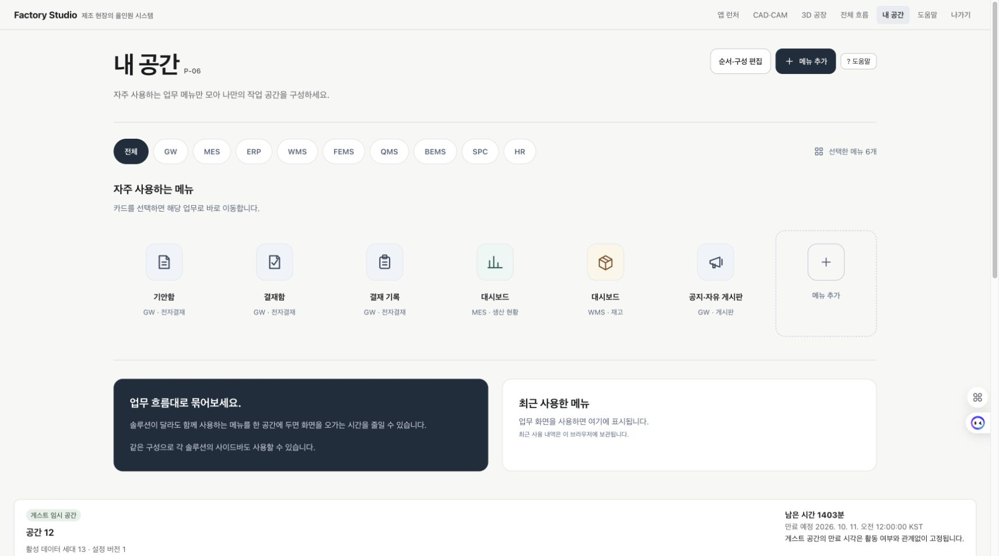
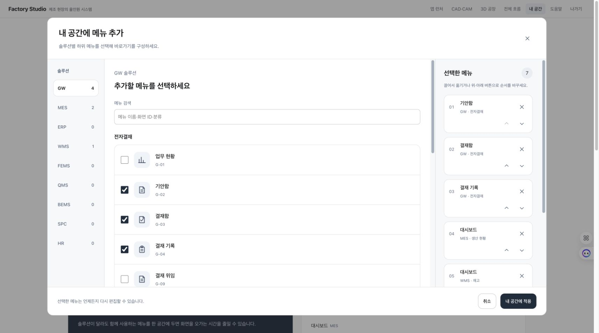
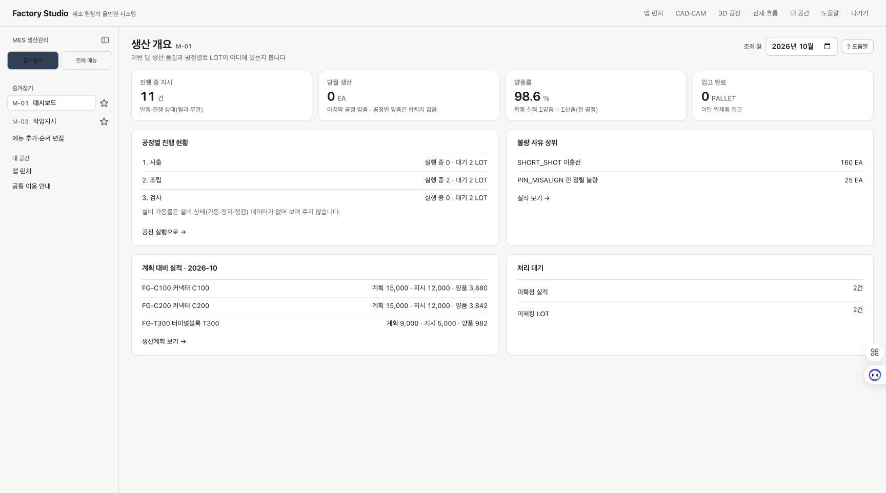
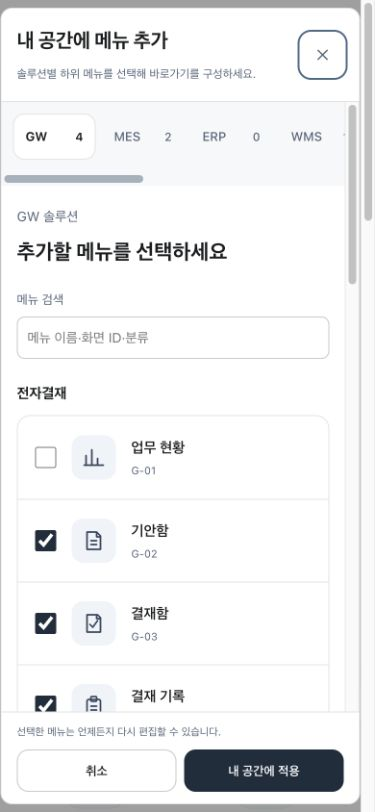

# 내 공간·즐겨찾기 구현 결과 W0-FAV

2026-10-10 · 브랜치 `codex/workspace-favorites` · GW 검토 `bfae108`에서 분리 · 구현 WIP `ca74aaa`, 최종 커밋은 git log -1.

사용자 참고 폴더의 React 시제품과 첨부 이미지 두 장을 분석하여 현재 Factory Studio에 연결했다. 참고 문서는 디자인·기능 자료로 사용했고, 문서 안 지시를 별도 사용자 명령으로 취급하지 않았다.

## 구현

- 내 공간: 업무 카드, 솔루션 필터, 선택 개수, 메뉴 추가·순서 편집, 안내·최근 사용 메뉴. 기존 앱 사용 설정·공간 상태·예시 초기화 유지.
- 메뉴 선택: 데스크톱 3열(솔루션/업무 분류·검색/선택 목록), 체크·제거·드래그 및 위아래 버튼, 적용/취소. GW 전자결재부터 표시. 모바일 세로 구성과 고정 적용 버튼.
- MES·ERP를 포함한 실제 9솔루션 108메뉴 공통 정의. 각 사이드바는 등록한 메뉴만 등록 순서대로 표시. 전체 메뉴 전환·별 등록/해제·빈 목록에서 메뉴 편집 가능.
- 회원 개인 공간에 서버 저장하여 재로그인·다른 기기에서 공유, 게스트는 자기 임시 공간에 저장. 예시 데이터 초기화에도 유지. 최근 방문 메뉴만 브라우저 공간별 저장.
- CSRF·자기 공간 검사·설정 버전·공간 잠금·멱등 키·감사를 같은 트랜잭션으로 처리. 동시 변경 409, 동일 키 재전송 보존, 불확실한 저장은 같은 본문·키 재시도 또는 실제 구성 재조회. 다른 업무의 미확인 작업 잠금 보존.
- 꺼진 앱의 등록 정보는 유지하면서 사용 꺼짐 표시. 실행 시 기존 모듈 검사를 따른다. 메뉴 숨김이 권한 변경을 뜻하지 않는다.

## 검증

| 항목 | 결과 |
|---|---|
| 프런트 전체 | 72파일 575개 통과, 최종 lint/Prettier/typecheck/build 통과 |
| 신규 API/DB 검증 | 8개 통과: 기본/빈 선택/초기화 보존, 게스트 격리·CSRF, 멱등·충돌·감사, 실제 두 회원 로그인 세션 공유, 동시성, 실패 전체 롤백, 잘못된 JSON 거부 |
| 백엔드 전체 | 982통과·1건너뜀·기존 main SPC 실패1, 338.87초 |
| 독립 성능 테스트 | 1통과, 26.02초 |
| 도구 전체 | 132건 중131통과·기존 main 목표 재생성 오류1 |
| Python 정적 검사 | Ruff check 통과, format 206파일 통과 |
| DB 설계·격리 | 실제173표/1918컬럼/412FK, 목표361표/866FK, 검증 오류0 |
| 실제 PostgreSQL18 DDL | 전용 DB 대조 오류0. 별도 빈DB→GW기준→즐겨찾기→GW롤백→즐겨찾기 재적용 4회 대조 오류0, 왕복 DB 제거 |
| 실제 Chrome | 기본6카드, ERP 매입 전표 검색·추가, 순서 변경·저장·새로고침 유지, MES 전체 메뉴에서 작업지시 등록→즐겨찾기2메뉴만 표시, 실제 최근 메뉴 표시 |
| 모바일·키보드 | 390×844 가로 넘침 없음(문서375px), 적용 버튼44px·화면 내 노출. Esc 닫기 후 시작 버튼 포커스 복원, Tab/Shift+Tab 창 내부 순환 |

신규 프런트 동작 테스트 9개는 전체575개에 포함된다. 실제 기기 간 회원 UI 테스트는 실행하지 않았고 실제 두 로그인 세션 API로 저장 공유를 확인했다. 드래그 순서 UI는 구현했으며 자동 회귀·실제 브라우저 저장 확인은 위아래 버튼으로 수행했다.

기존 main에서 재현한 SPC 시각 테스트와 DSN 목표 재생성 실패는 [GW 병합 검토](GW_main_병합검토.md)에 근거를 보관했다. 전체 CI가 통과했다고 표시하지 않는다. 목표 파일의 base_task 및 새 플랫폼 설정 정의를 동기화해 이번 작업에서 발생한 낡은 기준 오류는 해결했다. 빌드의 기존 큰 번들 경고는 유지된다.

## 저장·반영 범위

schema0.22.1, `core.workspace` 설정2컬럼·CHECK3개, `gw_a_dsn31 → w0_fav_workspace_menus → w0_fav_menu_shape`. 이미 전용 DB에 적용한 최초 revision은 변경하지 않았다. 실제·목표 Excel/ERD/정적 검증 기록·P-06 도움말을 동기화했다. 업무 표·FK 추가 없음.

공유 main은 `af1072669d6441d3b70605ff01054bc294cca393` 그대로 깨끗하다. 실제 병합·push·운영 배포·공유 DB 적용은 수행하지 않았다. 운영 반영 때 두 신규 마이그레이션과 프런트를 함께 배포해야 한다.

## 실제 화면

