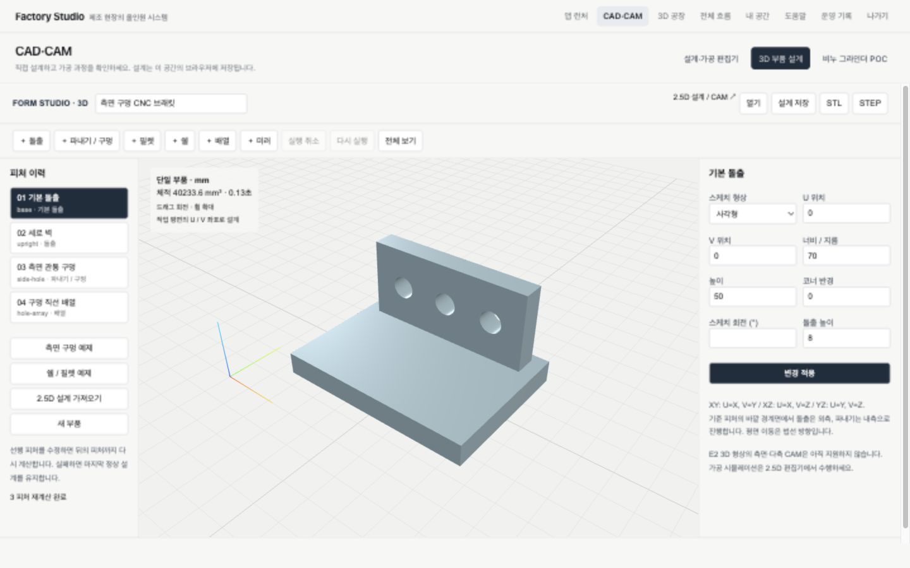
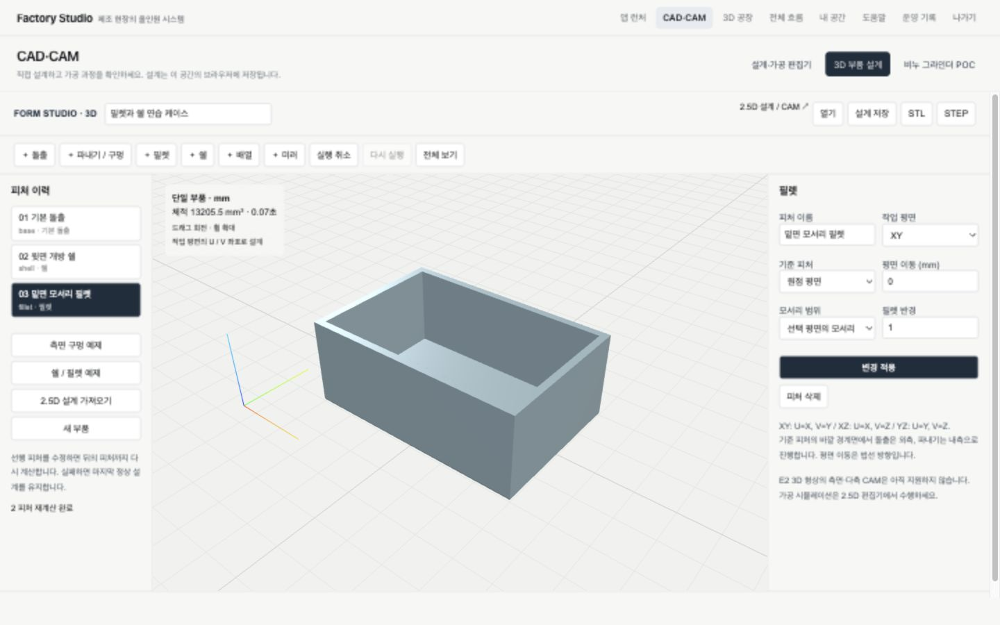

# CAD-07 / E2 부품 설계 검증 보고

2026-10-07 완료. 사용자 ‘E2 범위 진행’ 지시를 기존 권장안 승인과 함께 적용했다. 하나로 연결된 부품의 피처 설계를 구현했으며, 조립(E3)과 측면/3D CAM(E5)은 이번 결과 확인 이후다. 기존 E1·관리자 비누/연구노트의 경계는 유지한다.

## 결과와 사용 방법

로그인 후 CAD·CAM → **3D 부품 설계** 탭(`?view=part`). 좌측 측면 구멍/쉘 예제로 시작하거나 기본 돌출을 수정한다. 위 버튼으로 피처를 추가하고 작업 평면·선행 기준·치수를 입력한 뒤 변경 적용한다. 피처 이력에서 앞 치수를 바꾸면 후속 형상을 다시 계산한다.

- 돌출/파내기, 원을 이용한 측면 구멍, XY/XZ/YZ와 선행 피처 경계면·법선 이동, 스케치 회전.
- 앞 돌출/파내기 원본의 직선/원형 배열과 미러. 32피처·16개 배열·총128인스턴스 상한.
- 실제 BRep 필렛(전체/선택 평면 모서리), 쉘(평면 면 제거·안쪽 두께).
- 자유 선/3점 원호 혼합 윤곽, 점·경유 좌표·수평/수직/일치/길이/원호 반경/고정점 구속. 수치 해석 후 적용하며 중복·모순·교차 윤곽 거부.
- 실패 ID와 이후 미계산 표시, 마지막 정상 모델/표시/저장 유지. 검증 성공 뒤에만 undo/redo와 로컬 저장 확정. 취소/30초 한도는 Worker 종료.
- 편집 원본 JSON v3, v1/v2 base/cut 가져오기, 기존 E1과 별도 공간별 저장. STL·STEP 내보내기. 이력은 JSON에 있으며 STEP/STL에 없다.

예제 원본: [브래킷](../../prototypes/cad-cam/examples/cnc_E2_2026-10-06_bracket.part.json), [쉘/필렛](../../prototypes/cad-cam/examples/cnc_E2_2026-10-06_shell-fillet.part.json). 파일명 날짜는 생성일을 보존한다. 비누 설계/성능 이력을 새로 만들거나 사진 업로드를 추가하지 않았다.

## 실제 검증

Node24, replicad/replicad-opencascadejs 각각1.1.0 고정. Manifold3.5.4는 기존 E1 CAM offset용으로 유지한다.

| 검증 | 결과 |
|---|---|
| prototype `npm test` | 50 통과. 실제 OCCT 솔리드/해석 부피·plane 참조 재계산·측면 구멍/배열/미러·쉘/필렛·원호·실패 ID·구속 성공/모순·JSON 왕복·STEP/STL 내용 |
| frontend `npm test` | 63파일/525 통과. 추가 E2 게스트 진입·scope·활성 탭·E1 복귀, 관리자 POC 경계 유지 |
| backend `tests/test_cad_private_assets.py` | 13 통과. 보호 자산의 기존 권한 경계 |
| prototype 포맷/단독 빌드 | 통과 |
| frontend 전체 build / 공개·관리자 자산 분리 | 통과. main의 frontend 단독 설치 재현 결과는 아래 통합 기록 |
| 실제 브라우저 | 합성 관리자 5243/8043 fixture. 포털 탭/원본 복원·치수 재계산·구속·실패 보존·undo/redo·STEP 생성 완료·1440×900 및390×844 화면 확인 |

브라우저 수치: 브래킷40233.6mm³, 기본 높이8→12 변경 후54233.6mm³. 앞 돌출 U=150은 `upright` 실패와 마지막 정상 체적 유지. 쉘/필렛13205.5mm³, 수평 구속으로 두 점 V가-9로 보정되어5700mm³, 선→원호 변환 후4678.1mm³. 중복 수평 구속은 거부. 이번 PC의 예제 커널 계산 표시 약0.00~0.19초이며 다운로드·초기화 시간을 포함하는 성능 보증이 아니다.

WASM 크기22,980,267 bytes(약23MB), 빌드 gzip 약7.32MB. E2 페이지의 Worker에서만 불러온다. 기본 2.5D 진입은 이 커널을 내려받지 않는다. MIT/LGPL-2.1 텍스트·상류 소스/빌드/교체 안내를 공개 `licenses`에 포함했다. Node 분기 `node:module externalized`와 큰 청크 빌드 경고는 남지만 실제 브라우저 Worker 실행은 통과했다. 기존 개발 의존성 source-map-js audit high1은 이번 이전부터 존재하며 범위 밖이다.

## 제약과 미검증

- 기준 평면은 원점 또는 선행 피처 전체 경계의 바깥 평면이다. 임의 곡면·개별 face/edge 영구 추적·임의 축 작업면은 미구현. 필렛/쉘은 형상에 따라 실패하며 정확한 실패 피처를 표시한다.
- 단일 연결 솔리드·단일 닫힌 윤곽만 지원. 일치 구속이 면을 퇴화/교차시키면 형상 검증에서 거부한다. 완전한 범용 구속 솔버가 아니다.
- E2를 평면 CAM으로 자동 변환하지 않는다. 기존 E1 상면 2.5D CAM만 사용 가능. 조립·NC·실제 기계 간섭/연속 충돌·물성/비누 성능·실물 제작은 미구현/미검증.
- DB 변경 없음. `db:validate`, `db:build`, ERD 재생성·실제DB 검증은 실행하지 않았다.
- 브라우저 STEP Worker 완료 메시지와 Node STEP/STL 바이트를 확인했다. 외부 CAD에서 STEP 다시 열기·브라우저 다운로드 파일의 디스크 확인/파일 선택 재열기는 미검증. JSON 원본 왕복은 순수 테스트에서 통과했다.
- 수동 계산 취소/30초 제한 코드는 존재하지만 실제 긴 계산으로 해당 경로를 재현하지 않았다. 서버 동기화/클라우드 저장/다중 사용자 편집 없음.

## 통합 기록

WIP0377787·추가7ed2817, W0-5 e135f79를 b7edf18로 병합해 보존했다. 사용자 기존 main push 승인으로 로컬 main 통합/push를 진행하며 완료 결과를 이 문서와 progress/HANDOFF에 덧붙인다. 운영 배포는 하지 않는다. 다음 E3는 결과 확인 뒤 진행한다.
