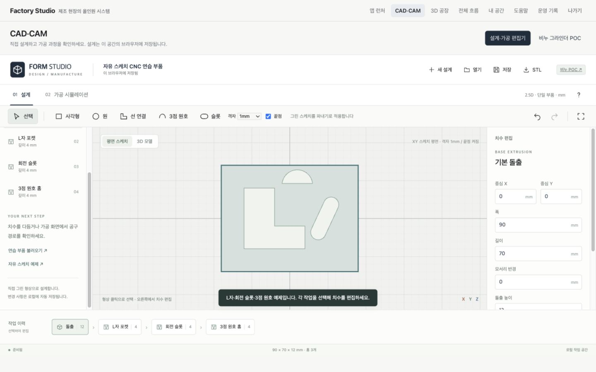
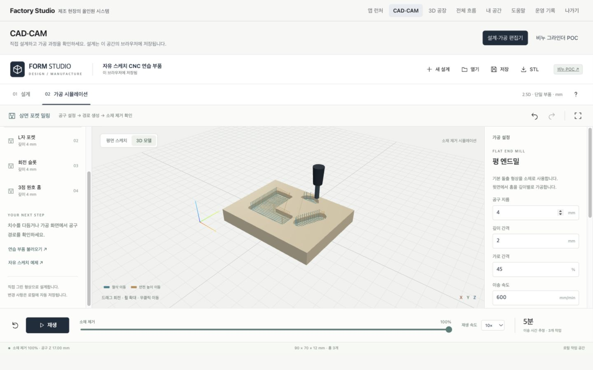

# CAD-06 · E1 자유 스케치 편집기 구현 결과

2026-10-06. 사용자가 상세 고도화 분석의 권장안대로 이어가기를 승인했다. CNC 우선 E1을 실제 기존 웹 편집기에 연결했다. 비누 물성·제작 심화와 E2 이상은 이번 범위가 아니다.

## 사용 방법과 파일

선 연결은 작업면을 클릭해 점을 추가하고 첫 점을 다시 클릭하거나 ‘윤곽 닫기’로 마친다. 마지막 점 취소·스케치 취소를 제공한다. 3점 원호는 시작·통과·끝 순서로 클릭하면 끝에서 시작까지 직선으로 닫힌 면을 만든다. 슬롯은 전체 길이·폭·회전 각도로 편집한다. 각 윤곽은 기존 돌출 또는 상면 파내기에 적용한다. 원호와 직선이 섞인 데이터는 JSON 표현에서 보존되지만 화면에서 이어 붙이는 혼합 곡선 도구는 아직 없다.

오른쪽의 점 X/Y·원호 통과 X/Y는 좌표 치수 편집이다. 치수를 연동하는 수평/수직/접선 구속 해석기가 아니다. 격자는 끔/0.1/0.5/1/5mm, 끝점 스냅은 8화면픽셀 이내에서 우선한다. 열림·교차·중복점·퇴화·일직선 원호·잘못된 치수를 적용하면 원래 설계를 유지한다.

JSON v2는 형상/작업 ID와 nodes의 꼭짓점 ID·point·arcVia를 보관한다. x/y는 윤곽 좌표의 이동 기준이며 기하학적 무게중심을 의미하지 않는다. w/h는 윤곽 근사 경계의 외접 치수다. v1 사각형/원은 형상을 바꾸지 않고 v2로 읽는다. 기존 브라우저 저장 키 v1은 유지해 설계를 복원한다. 100KB·64점·4096근사점·32홈·200mm 평면 치수 상한이 있다. 원호 현 오차 목표는0.01mm다.

예제 파일: [cnc_E1_2026-10-06_L-slot-arc.form.json](../../prototypes/cad-cam/examples/cnc_E1_2026-10-06_L-slot-arc.form.json). 합성 L자/회전 슬롯/원호이며 왼쪽 ‘자유 스케치 예제’ 버튼에서도 읽는다. 비누 연구노트에 신규 실험이나 실물 검증을 추가한 파일이 아니다.

## CNC와 검증

Manifold3.5.4(기존 E0 선택)을 런타임으로 고정하고 WASM을 가공 Worker에서 초기화한다. 자유 윤곽의 inward offset, 스캔라인 절삭 구간과 윤곽 마무리 경로를 계산한다. 각 분리 구간 전후에는 안전 높이로 올린 후 XY 이동/수직 진입한다. offset 결과가 비거나 원래 경계의 공구 여유 표본 검사가 실패하면 전체 경로 생성을 거부한다. 계산 중 설계/공구 변경 시 revision이 다른 응답을 버린다. 커널 객체는 계산 후 해제한다.

- Node24 prototype37개 통과: v1/v2 원호·ID 왕복, 교차/퇴화 거부, 오목 소재·절삭 체적, 회전 슬롯·관통 소재 제거, L/좁은목 분리 경로 공구 여유·급속 높이·과대공구 거부, 기존 형상/노트/POC 회귀 포함.
- frontend524개/63파일 통과, 타입 검사+전체 build 통과, 공개 CAD와 관리자 비누 자산 분리 검사 통과. node:module externalization/기존 큰 청크 경고 존재. 브라우저에서는 Node 분기 없이 WASM Worker가 실제 동작했다.
- 실제 브라우저1440×900에서 L자6점을 직접 클릭해 닫기, 슬롯30×10/65° 추가, 원호3점과 통과Y32 편집, 3작업 CNC 생성 확인. 완료 제거6.00cm³, 20% 되감기1.53cm³. 격자0.60mm 근사 결과이며 실제 절삭량 측정이 아니다.
- main 폴더의 frontend 의존성만 설치된 환경에서 WASM ?url alias 해석 실패를 발견했다.057100d에서 query를 보존하는 정규식 alias로 수정하고 동일 main CAD 빌드/자산 분리를 재검증해 통과했다. 공개 Worker/WASM 산출물 해시도 작업 폴더와 일치한다.
- 병합 후 관리자 자산 접근 API13개 통과(401/403/200 역할 검사).
- 새로고침으로 설계 복원,390×844에서 도구/좌표 편집 접근, 중복점 적용 거부/40mm공구 경로 거부 확인. 콘솔 error0 확인(해당 검증 시점).
- 브라우저 저장 버튼은 성공 토스트를 보였으나 IAB Blob 다운로드 이벤트가 timeout됐다. 실제 다운로드 파일과 파일선택 재열기는 이번에 검증 완료로 표시하지 않는다. JSON 순수 파일 왕복·리포지토리 예제 저장은 검증했다.

## 제약과 다음

단일 XY 소재/상면 홈의2.5D 검토용이다. 섬 생성 UI·완전 구속·다중 돌출·다른 평면·필렛·쉘·조립·STEP·NC는 아직 없다. 공구 여유는 경계/경로의 표본 검사이며 연속 충돌·공구 홀더·고정구·절삭력·실제 기계를 검증하지 않았다. 실제 DB/스키마 변경이 없어 DB 명령은 실행하지 않았다. 기존 frontend 개발 의존성 source-map-js1.2.1 audit high1은 시작커밋에도 존재했다.

다음CAD-07/E2는 이번 결과 사용자 확인 뒤 세부 범위에 들어간다. 비누 연구노트는 관리자 기록+폴더/파일명 방식과 기존 설계 이력을 유지한다. 구현09286e4와 최신 W0-4 be91ce9를 병합한4c87b7c를 로컬 main에 fast-forward하고 origin/main push 성공을 확인했다. 운영 배포는 별도다.

## 실제 포털 검증 화면

