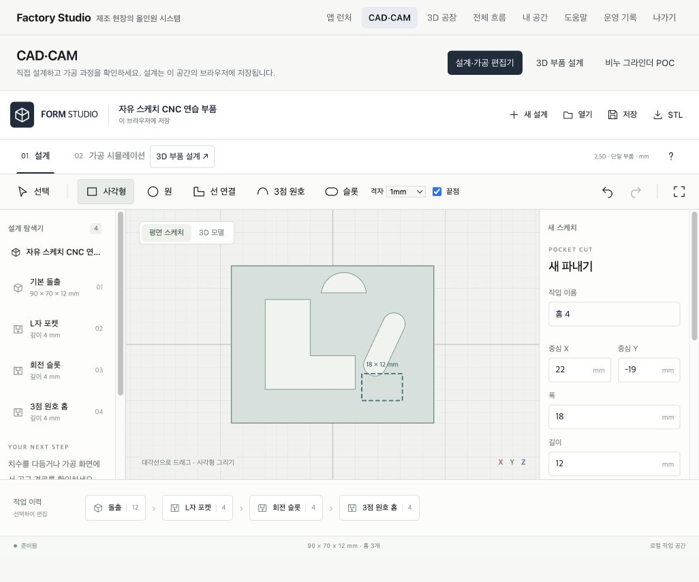
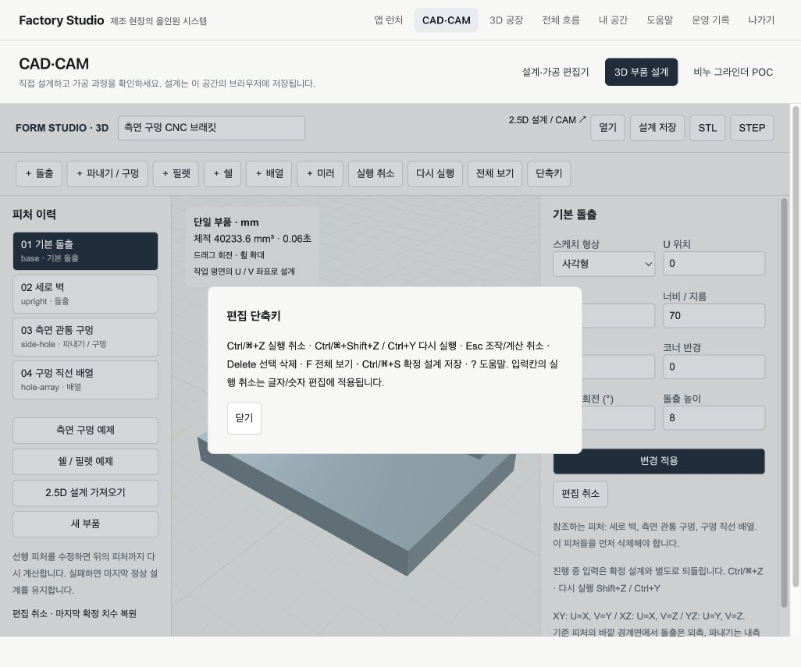

# CAD-11 편집 명령·실수 복구 검증

2026-10-07 · 구현 완료100% · 운영 배포 없음

사용자가 CAD-10 권장안대로 진행하도록 승인했다. 3축 밀링·G-code를 우선하고 선반은 후속으로 둔다. 이번 작업 ID는 CAD-11이며 NC 입력/에너지 모델은 CAD-12~15에 남아 있다. [계약](../modules/cad-cam/편집명령_복구_설계_CAD-11.md).

## 변경

E1/E2에 공통 키 명령을 연결하고 입력칸 기본 undo와 초안/확정 모델 이력을 분리했다. E1 점/원호/윤곽 닫기/드래그 및 E2 필드/스케치 편집을 복구한다. 실패 원호는 이전 두 점 유지, Esc는 확정 값을 복원한다. E2 계산 취소는 Worker 종료와 인스턴스 검사를 사용한다. E2 참조 피처 삭제 영향 목록과 거부를 제공하며 성공한 삭제는 undo로 복구한다. 도움말·툴팁·편집 취소 버튼을 추가했다.

구현6d4d8d3, main의 HR 급여aaee3a3를 보존 병합했다. schema/API/권한/공개 비누 자산 정책 변경 없음.

## 실행한 검증

| 검증 | 실제 결과 |
|---|---|
| prototype `npm test` | 62 통과, 실패0(신규6) |
| prototype `npm run format:check` | 통과 |
| frontend `npm test` | HR 병합 후66파일·538 통과 |
| frontend `npm run build` | 전체 빌드·CAD E1/E2 빌드·공개/비공개 자산 분리 통과 |
| `git diff --check` | 통과 |

신규6테스트는 Windows/Mac 라우팅, 입력칸/IME/repeat/Alt 제외, 점ID/원호/닫기 스냅샷, 연속 입력/드래그 그룹·새 변경 redo 초기화, no-op/취소/상한, 피처 직접·간접 참조를 확인한다.

로컬5243/8043의 합성 관리자 fixture에서 실제 iframe 버튼/키보드/드래그를 확인했다.

- E1 선 세 점→⌘Z 두 점→CtrlY 세 점. 닫기→⌘Z 열린 세 점, 확정 부품/기존 홈3개 유지. Esc 초안 취소.
- E1 일직선 세 점 원호 실패→이전 두 점 유지. 수정한 세 번째 점→원호 완료→⌘Z 두 점→CtrlY 통과점/닫기 복구.
- E1 사각형 드래그18×12→⌘Z 초기40×30→CtrlY18×12. 한 드래그만 취소하며 확정 모델 유지.
- E2 돌출24→초안26→⌘Z24→CtrlY26, 확정 전 체적 유지. 적용 후 체적13205.5→13973.5mm³, ⌘Z로24/13205.5mm³ 복원.
- E2 redo 계산 도중 Esc 취소→마지막 정상 모델 유지. 입력칸 부품 이름에 타이핑 후 ⌘Z는 문자만 취소하며 피처/체적 유지; Esc 이름 복원.
- E2 세로 벽 Delete→측면 구멍·배열 참조 목록과 거부, 기존 모델 유지. 마지막 배열 Delete→피처3개/41037.9mm³→⌘Z 피처4개/40233.6mm³ 복원.
- 도움말 열기/Esc 닫기, 초안 안내/취소/redo 버튼 상태 확인.

## 제약과 미실행

30초 만료·취소 Worker의 늦은 메시지 강제 주입·실제 IME/Windows/모바일 기기·저장 단축키 파일 재열기는 브라우저에서 미실행이다. 키 라우팅과 이력 경계는 자동 테스트로 확인했다. E2 모든 개별 스케치 도구의 undo 조합을 전수 시험하지 않았다. 입력칸 자체 undo는 브라우저가 문자 단위로 묶는 방식에 따른다. 기존 OCCT WASM 약23MB 및 큰 chunk 경고 유지.

DB 명령·실장비 CNC/NC 가져오기·전력 실측·에너지 절감률·운영 배포 미실행. NC 파일만으로 원래 CAD 편집 이력을 복원하거나 장비 전력을 확정할 수 없다.

## 다음 작업 / 재현

결과 확인 뒤 CAD-12 3축 밀링 G-code 부분집합·모달 상태·원본 행/3D 경로·미지원 분석 차단·취소/상한부터 진행한다. 품질1/에너지2 제안은 소재/공구/장비전력 조건이 마련된 CAD-13~15 범위다. CAD-12~17 자동 착수 없음.

Node24 PATH를 적용하고 `npm --prefix prototypes/cad-cam test`, `npm --prefix prototypes/cad-cam run format:check`, `npm --prefix frontend test`, `npm --prefix frontend run build`로 재현한다. 브라우저는 `/cad-cam`, `/cad-cam?view=part`에서 버튼에 포커스를 둔 후 키를 시험하고 입력칸의 native undo와 구분한다.
