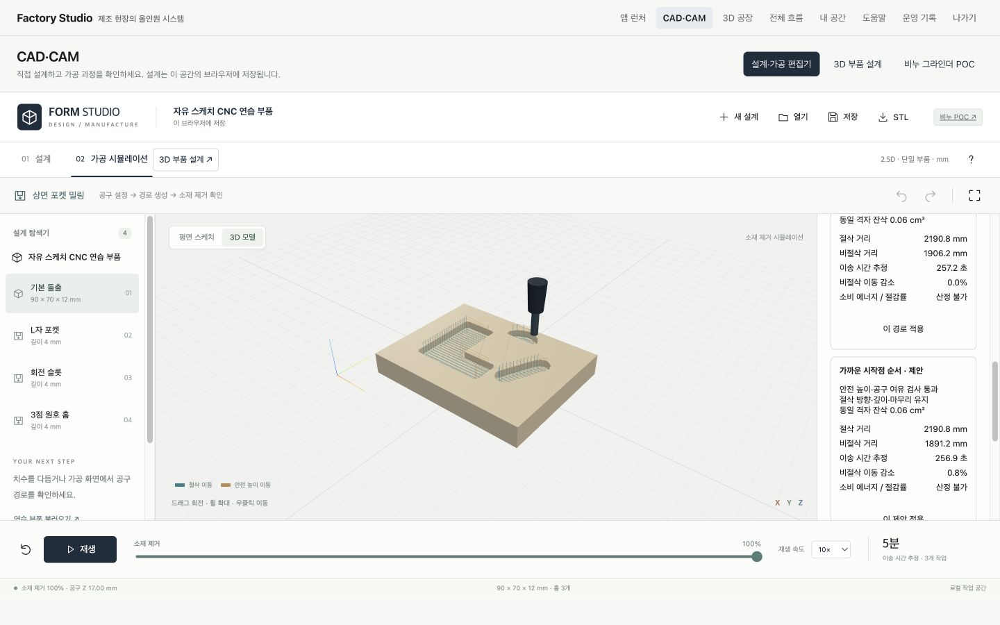

# CAD-09 품질 우선 경로 제안 구현

2026-10-07 사용자 ‘제안안으로 구현해줘’ 승인. 검토한 후보 중 안전·디지털 형상 품질을 보존한 비절삭 이동 감소 제안이다. 실제 전역 최적 경로나 물리적 품질 보증이 아니다.

## 구현

- `/cad-cam` → 가공 시뮬레이션 → **품질 우선 경로 제안** → 후보 비교 → **이 제안 적용**. 제안 조회만으로 현재 경로/가공 진행률을 바꾸지 않는다. 적용 시 새 시뮬레이션 세대로 0%부터 시작한다. 모델/공구 입력 변경은 경로와 후보를 무효화한다.
- E1 상면 2.5D 포켓. 공구·이송·스텝다운·스텝오버·안전 높이 유지. 같은 피처/깊이의 래스터 방문만 가까운 시작점 순서로 재정렬한다. 스트로크 방향·피처/깊이 순서·마지막 마무리 윤곽 유지, 매 구간 사이 안전 높이로 후퇴.
- 기존 순서와 가까운 시작점 순서, 총 2후보(설계 상한3 이내). 동일 깊이 최대256 래스터 초과 시 기존 후보만 표시한다. 기존보다 개선되지 않으면 기존을 제안한다. 60,000 경로점 상한 유지. Worker 30초 종료·수동 취소·종료한 Worker/다른 모델 revision 응답 무시.
- 방향 있는 절삭 세그먼트 다중집합, 공구, 피처/깊이 순서, 실제 절삭열 마지막의 마무리 윤곽을 검증한다. 경계 거리 0.1mm 표본과 안전Z 독립 검사, 동일 격자 최종 높이 배열 비교 후에만 후보 인정. 격자 제거/잔삭은 근사이며 실제 Ra/공차/진동/고정구·홀더 충돌 검증은 아니다.
- 후보 카드: 안전/품질 보존, 같은 격자 잔삭, 절삭·비절삭 거리, 이송 시간 추정, **비절삭 이동 감소%**, 소비 에너지/절감률 **산정 불가**. 장비·재질·실측 전력 입력이 없는 초기 범위이므로 kWh나 전력 절감%를 만들지 않는다. 시간은 절삭 이송과 기존 3000mm/min 비절삭 가정이며 가감속·공구 교환·실기계 시간은 포함하지 않는다.

## 실제 검증

- prototype **56 통과**(기존50 + 새6): 분리 포켓 동일 절삭·방향·깊이·마무리·격자 최종 결과, 독립 거리/시간 합산, 기존보다 나쁜 제안 방지, 공구 변경/절삭 누락 거부, 절삭 서명을 유지한 저고도 급속 거부, 실제 마무리 순서 변경 거부, 256개 상한/큰 공구 거부, kWh/에너지 절감률 null.
- 분리 포켓: 비절삭 **3927.4 → 2034.1mm(48.2% 감소)**, 이송 추정 **314.4 → 276.6초**, 최종 격자/잔삭 동일. 이 수치는 전력 절감률이 아니다.
- HR W1b-1 `1136611` 보존 병합 후 frontend **530/64파일 통과**, 전체 build·CAD 자산 분리·prototype 포맷 통과. DB 변경 없음, DB 검증/실물 절삭/전력 계측은 실행하지 않았다. 기존 큰 번들 경고 유지.
- 실제 합성 관리자 웹 Worker: 자유 윤곽3개 후보 생성, 조회 후 적용 전 재생 비활성, 선택 적용/100% 소재 제거 **6.00cm³·잔삭0.06cm³**, 이송 입력 변경 시 후보 제거/재생 비활성, 기존 경로 생성, 기존100% 경로에서 후보 조회해도100% 유지, 256상한 기존 후보, 즉시 수동 취소/상태 표시/재계산 복구 확인. 실제 브라우저 30초 시간 만료와 강제 stale 응답 주입은 미실행(코드 방어만 확인).
- 기본 작은 화면에서 카드/적용/설정 동작, 1440×900 비교 카드·3D·100% 표시 확인. 검증 화면은 아래. 임시 viewport는 복원했다. 브라우저 검증 서버는 5243/8043 모의 인증 fixture이며 운영 서버가 아니다.

## 반영과 다음 작업

구현 `b10d157`, HR 보존 병합 `6f91b4c`, branch `codex/soap-cad-review`. 현황·progress·HANDOFF를 함께 기록한다. 사용자 기존 main push 승인에 따라 통합/push하되 운영 배포는 별도다. 최종 기록 커밋은 `git log -1`로 확인한다.

재현: Node24 PATH 설정 후 `npm --prefix prototypes/cad-cam test`, `npm --prefix prototypes/cad-cam run format:check`, `npm --prefix frontend test`, `npm --prefix frontend run build`.

다음은 이번 결과 확인 뒤 장비/재질/공차·Ra 및 실측 전력 입력 설계. E2 3D/측면 CAM·NC·FEMS/DB 연동은 이번 범위 밖이다. 후속 작업 ID를 자동 시작하지 않는다.
