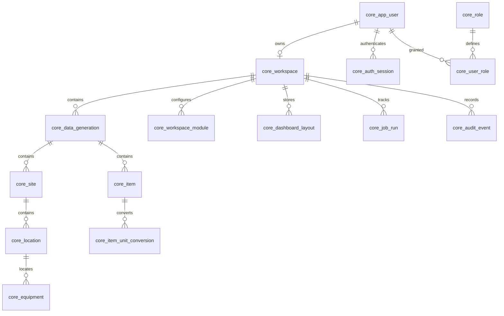
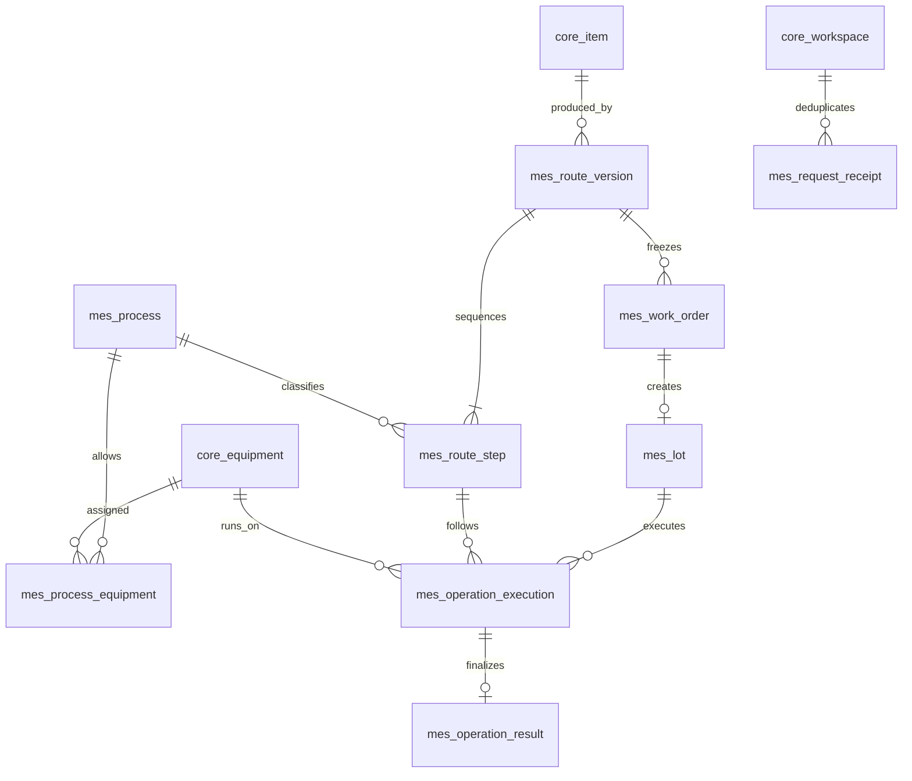
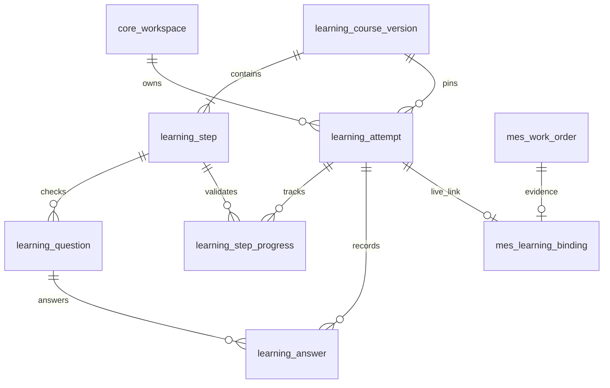
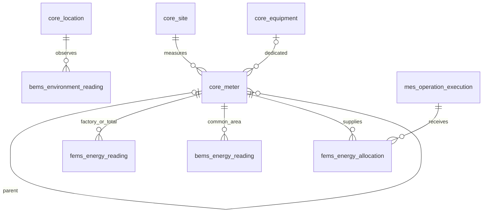

# FS-005 공통 ERD 및 데이터 관계

> FS-008b 후속 결정: core.dashboard_layout은 삭제됐다. 아래 당시 목록은 이력이며 현재 엔티티·배분 quantity/unit·소유 모듈 정리는 [v0.9.0 설계](../db/스키마_재구성_FS-008b.md)를 따른다.

작성일: 2026-09-20. 상태: 논리 설계 완료, 물리 DDL·실행 검증 전.

> **이 문서는 36개 엔티티 시점의 v1 기준본이다.** 이후 FS-005a(게스트·ERP-1·프로세스 맵), FS-006b(게스트 주체·계획 연결·패킹출하),
> FS-007b(모듈별 명세·ERD)를 거치면서 **54개 테이블 / 510컬럼 / FK 113**개로 확장되었다.
> 현재 기준본은 `../db/schema-metadata/schema.json` v0.3.0과 `../db/DB설계서.xlsx`이며,
> 모듈별 관계도는 `erd/EIP_모듈별_ERD.html`을 본다. 이 문서는 설계 근거와 원칙 추적용으로 보존한다.
범위: core/learning/MES와 FEMS/BEMS 연결. QMS/WMS/ERP 테이블은 이번에 생성하지 않는다.
기준: FS-003 업무 카드, FS-004 AC-01~34. 이름과 키는 설계 후보이며 FS-006에서 상태/트랜잭션, FS-007에서 컬럼별 타입·NULL·검증 규칙을 확정한다.

## 1. 설계 결정
- 단일 DB 안의 모듈별 스키마로 책임을 분리한다.
- 물리 이름 후보는 소문자 snake_case, 키는 id와 의미가 명확한 xxx_id를 사용한다. 원본 대문자/접두어 표기와 업무 개념 대응을 유지한다.
- 업무 행의 범위 S=(workspace_id, generation_id). 일반적인 업무 PK id와 함께 UNIQUE(S,id)를 두고 업무 간 FK는 (S,참조id)로 연결해 교차 공간/세대 참조를 막는다. 실제 PK 타입은 FS-007에서 확정한다.
- 업무 코드 UNIQUE는 S 안에서 적용한다. 같은 표시 작업지시번호를 다른 학습자가 사용할 수 있다.
- 체험 공간 소유자는 계정과 연결한다. 최초 버전은 사용자당 개인 공간 1개이며 공용 협업 공간은 후속이다.
- 계정·설정·학습 기록은 보존, 가상 기준정보와 실적·계측은 세대별 교체이다. 사용자 작성 기준정보도 체험 데이터이므로 초기화된다.
- DB FK는 관계 정합성, 서버 권한 검사는 요청 접근 범위를 담당한다. FK만으로 타 사용자 접근이 차단된다고 간주하지 않는다.

## 2. 계정·공간·설정 ERD
아래 Mermaid는 핵심 관계를 보여준다. 이름은 스키마를 밑줄로 구분한 ERD 별칭이며 실제 SQL 이름은 목록의 schema.table이다.

workspace.active_generation_id는 같은 workspace의 generation만 가리킨다(같은 공간의 복합 FK 후보). 순환 생성을 피하기 위해 초기 준비 중에는 NULL을 허용하고, 세대 검증·전환 후에만 업무 API를 사용 가능하게 한다.

| 엔티티 | 주요 속성/관계 | 고유성·보존 |
|---|---|---|
| core.app_user | 로그인 식별자, password_hash, 계정 상태 | 로그인 식별자 UNIQUE. 보존 |
| core.auth_session | user_id, 세션 토큰 해시, 만료/취소 시각 | 해시 UNIQUE. 만료 정리, 실습 초기화와 무관 |
| core.role | role_key, 설명 | role_key UNIQUE. 배포 관리 |
| core.user_role | user_id, role_id | 쌍 UNIQUE. 보존 |
| core.workspace | owner_user_id, active_generation_id, config_version | owner UNIQUE. 보존 |
| core.data_generation | workspace_id, seed_version, 기준 날짜, 준비 상태, 활성/퇴역 시각 | (workspace_id,id) UNIQUE. 메타데이터 보존 |
| core.workspace_module | workspace_id, module_key, enabled | (workspace,module_key) UNIQUE. 보존 |
| core.dashboard_layout | workspace_id, layout_key, schema_version, 위젯 목록/순서 | (workspace,layout_key) UNIQUE. 보존 |
| core.job_run | workspace_id, 작업종류, 실행 키, 시도, 상태·오류·시각 | 작업/공간/실행 키/시도 UNIQUE. 보존 기간 별도 |
| core.audit_event | workspace_id, actor_user_id, action, 대상 유형/식별 요약, 사유·시각 | append-only, 실습 초기화에서 보존 |
| core.site | S, site_code, 이름, timezone | (S,site_code) UNIQUE. 세대별 |
| core.location | S, site_id, parent_location_id, location_code, 종류 | (S,site,code) UNIQUE. 부모의 사업장 일치·순환 방지 |
| core.equipment | S, location_id, equipment_code, 설비 유형, 활성 | (S,code) UNIQUE. 세대별 |
| core.item | S, item_code, 이름, 기준단위, 품목 유형, 활성 | (S,code) UNIQUE. 세대별 |
| core.item_unit_conversion | S, item_id, from_unit, to_unit, factor | (S,item,from_unit) UNIQUE, factor>0. 세대별 |

역할별 권한과 내부 모듈/위젯 등록은 코드의 명시 목록으로 시작한다. 사용자 임의 메뉴 프로그램이나 권한 엔진 테이블을 먼저 만들지 않는다. 단위/상태 코드의 물리 저장은 FS-006/007에서 결정하되 임의 표시 코드 변경이 업무 규칙을 변경하지 않도록 한다.

## 3. 생산 ERD

| 엔티티 | 주요 속성/관계 | 고유성·책임 |
|---|---|---|
| mes.process | S, process_code, 이름, 유형, 활성 | (S,code) UNIQUE |
| mes.process_equipment | S, process_id, equipment_id | (S,process,equipment) UNIQUE, 유효 설비 허용 목록 |
| mes.route_version | S, item_id, route_code, version, 게시 상태 | (S,route_code,version) UNIQUE. 게시 후 단계 변경 금지 |
| mes.route_step | S, route_version_id, process_id, sequence_no | (S,route_version,sequence) UNIQUE. 같은 공정도 별도 단계로 식별 가능 |
| mes.work_order | S, order_no, item_id, route_version_id, plan_qty/unit, 상태, 계획·실제 시각 | (S,order_no) UNIQUE, 경로 품목 일치 |
| mes.lot | S, lot_no, work_order_id, route_version_id, 상태 | (S,lot_no), (S,work_order) UNIQUE. 첫 버전 1지시/1LOT |
| mes.operation_execution | S, lot_id, route_version_id, route_step_id, equipment_id, started_at/ended_at, 상태 | (S,lot,route_step) UNIQUE. 첫 버전 재실행/재작업 없음 |
| mes.operation_result | S, execution_id, input/output/good/defect_qty, unit, defect_reason, confirmed_at | (S,execution) UNIQUE. 확정 결과 1개, 이후 직접 수정 금지 |
| mes.request_receipt | S, actor_user_id, operation_key, request_key, request_hash, 결과 요약/대상, 완료시각 | (S,actor,operation_key,request_key) UNIQUE. 실제 효과와 같은 트랜잭션 |

실적은 시작 시 0인 완성 실적을 만들지 않고 진행 실행과 확정 결과를 분리한다. 결과 부재와 양품 0을 구별한다.

추가 정합성 계약:
- 작업지시의 item_id와 route_version의 item_id 일치: 해당 조합의 복합 UNIQUE/FK 후보를 정의한다.
- LOT의 route_version은 지시의 route_version과 일치, execution의 route_step은 해당 LOT 경로에 속해야 한다. 같은 S라는 사실만으로 경로 정합성이 충족되지 않는다. 참조 대상에 (S,id,route_version_id) 조합을 두는 방식으로 FS-007에 반영한다.
- 설비 허용 관계는 process_equipment에 기록한다. execution의 단계에서 공정을 찾아 유효한 조합인지 트랜잭션 내 검증한다.
- 입력=양품+불량=산출, 수량≥0. EA 정수·선행 양품 대사·완료 전이·시간 순서의 강제 위치는 FS-006/007에서 지정한다.
- 최종 양품·누적 불량은 확정 공정 결과에서 산출하며 초기에는 수정 가능한 별도 합계 컬럼을 중복 저장하지 않는다.
- 동일 키의 다른 본문은 거부한다. 서로 다른 요청 키로 같은 실행을 완료해도 result의 단일성 및 상태 검증으로 효과는 1회다.

## 4. 학습 ERD와 보존

| 엔티티 | 주요 속성/관계 | 고유성·보존 |
|---|---|---|
| learning.course_version | course_key, version, 제목, 게시 상태, 필요 모듈 목록 | (course_key,version) UNIQUE. 게시 후 불변, 보존 |
| learning.step | course_version_id, step_key, sequence_no, 안내·검증조건 버전/종류 | (course_version,step_key), (course_version,sequence) UNIQUE. 보존 |
| learning.question | course_version_id, step_id, question_key, 보기, 정답, 피드백 | (course_version,question_key) UNIQUE. 서버만 정답 전체 접근 |
| learning.attempt | workspace_id, course_version_id, source_generation_id, 시도 상태, 시작/완료 시각 | 시도별 id, workspace와 generation 메타 FK. 보존 |
| learning.step_progress | workspace_id, attempt_id, course_version_id, step_id, 검증상태·시각·validator_version, evidence_summary | (attempt,step) UNIQUE. 보존 |
| learning.answer | workspace_id, attempt_id, course_version_id, question_id, submission_key, 선택, 정오·시각 | (attempt,submission_key) UNIQUE. 답안 시도는 누적, 재전송은 중복 제외 |
| mes.learning_binding | S, attempt_id, work_order_id | (workspace,attempt), (S,work_order) UNIQUE. 현재 세대 업무에 대한 연결, 세대 정리 대상 |

attempt/work_order 연결은 연결 당시 같은 workspace·generation인지 검증하고 관련 복합 FK를 둔다. step_progress/answer가 다른 course_version의 단계·질문을 붙이지 못하도록 부모 조합을 UNIQUE/FK로 제한한다.

초기화 시 업무와 mes.learning_binding은 정리 가능하지만 attempt/step_progress/answer는 남는다. source_generation_id는 보존하는 세대 메타데이터를 참조한다. evidence_summary는 검증 당시 업무번호·최종수량·검증판정 등 최소 근거를 보존하며 업무 행으로 강제 FK를 만들지 않는다. 단, 현재 업무를 검증할 때는 요약값이 아니라 live binding과 실제 DB 상태를 읽는다.

부분 완료된 이전 시도는 새 세대 실습에 이어붙이지 않고 다시 준비 필요로 표시한다. 새 시도를 생성해 새 업무와 연결한다. 완료된 시도는 콘텐츠 버전과 함께 유지한다.

## 5. FEMS/BEMS 연결 ERD

| 엔티티 | 주요 속성/관계 | 제약·책임 |
|---|---|---|
| core.meter | S, site_id, location_id, parent_meter_id, equipment_id(선택), meter_code, owner_module, scope_kind, measurement_kind/unit | (S,code) UNIQUE, 부모 사업장 일치·순환 금지. 제조/공용/사업장 합계 범위 |
| fems.energy_reading | S, meter_id, owner_module=fems, observed_at, 값·단위·품질, source_key | (S,meter,source_key) UNIQUE. 제조와 사업장 주계측 소유 |
| bems.energy_reading | S, meter_id, owner_module=bems, observed_at, 값·단위·품질, source_key | (S,meter,source_key) UNIQUE. 공용 계측만 소유 |
| bems.environment_reading | S, location_id, sensor_key, metric_kind, observed_at, value/unit, 품질, source_key | (S,sensor,metric,source_key) UNIQUE. 온도/습도 등 |
| fems.energy_allocation | S, execution_id, meter_id, period_start/end, kwh, method/version, 근거 revision, 품질 | (S,execution,meter,period_start,period_end,method_version) UNIQUE |

core.meter의 (S,id,owner_module) UNIQUE를 소유 모듈 상수와 함께 참조하는 FK를 후보로 둔다. 동일 계측기가 두 모듈의 관측값 소유자가 되지 않도록 한다. 기존 관측값이 있는 계측기의 소유 모듈 변경은 금지하고 명시적인 이전 절차를 후속으로 둔다.

계측은 누적 전력량/순간 전력 등을 측정 종류로 구별한다. 값의 시각과 계산 구간·누락/리셋 품질을 검증한다. 계측기 자체는 전용 설비 또는 공용 구역을 가리키며, 공동 계측에서 실행별 소비량은 energy_allocation으로 배분한다. 실제 계측값과 배분값은 합산해 총량으로 만들지 않는다.

기간/단위/범위가 맞는 예시: 주계측 450 = 제조 288 + 공용 132 + 잔여 30 kWh. 제조 집계에 부모값과 자식값을 함께 더하지 않는다. 잔여가 음수이면 정상 잔여로 숨기지 않고 계측/집계 경계 불일치로 표시한다.

집계는 초기 SQL/서비스 계산으로 시작한다. 시계열 파티션·집계 캐시·전용 DB는 실제 부하에 따라 도입한다. 배분 실행 범위/방법별 중복과 총 배분량 검증은 FS-006 이후 상세화한다. FEMS만 켠 경우 관측 조회는 독립 제공하고 MES 연계만 사용 불가로 표시한다.

## 6. 초기화와 삭제 경계
| 데이터 | 주간 초기화 | 삭제/보존 의미 |
|---|---|---|
| 계정·권한·설정 | 유지 | 일반 업무 초기화와 무관 |
| 콘텐츠/과정 버전·학습 이력 | 유지 | 게시 버전과 결과 보존 |
| generation 메타·job/audit 기록 | 유지 | 작업 근거, 별도 보존 정책 |
| 공간의 기준정보·MES·계측·배분·live binding | 새 세대 교체 | 이전 세대 정리 가능 |
| 실제 회계·운영 증빙 | 현재 제품 범위 밖 | 향후 실서비스 별도 환경, 초기화 금지 |

새 세대 생성→동일 seed 검증→전환 잠금→활성 포인터 변경→진행 학습의 다시 준비 처리→구 세대 정리 순서이다. 실패하면 기존 포인터를 유지한다. 전환/업무 쓰기의 경합 제어는 FS-006에서 확정한다.
개별 업무 삭제는 RESTRICT 중심으로 검토하고, 관리용 세대 폐기는 권한 제한 CLI에서 자식→부모 순서로 수행한다. 보존 테이블이 업무 행 삭제에 연쇄 삭제되지 않도록 한다. append-only 정책의 업무 이력도 체험 세대 전체 폐기와 일반 사용자 수정 금지를 구분한다.

## 7. 원본 MES 설계 대응
| 원본 | 신규 책임/관계 |
|---|---|
| USER_MNG_MT / PERM_GROUP_MT / PERM_GROUP_DT | core 사용자·역할 + 서버의 action 권한. 메뉴 권한만으로 제한하지 않음 |
| SYS_GROUP_MT / SYS_CODE_DT / SITE_MAP_MT | 공통 코드 정책 및 코드 기반 앱 등록. 물리 코드 테이블 필요성은 FS-006/007 |
| ITEM_BASIC_MT / ITEM_UOM_DT | core.item / item_unit_conversion |
| WORKCENTER_MT | core.location의 작업장 + core.equipment 실제 설비 |
| PROCESS_MT | mes.process + route_version/route_step |
| WORK_ORD_MT | mes.work_order + 독립 mes.lot |
| WORK_OPR_DT | mes.operation_execution + operation_result |
| ACCESS_LOG_HT | core.audit_event. 접속/업무 변경 action 구분 |
| ITEM_BOM_MT / PARTNER_MT / ITEM_PRICE_MT | 후속 생산자재/ERP 범위, 현재 필수 FK로 만들지 않음 |
| WAREHOUSE_MT / LOCATION_DT / ITEM_INV_* | 후속 WMS. core.location의 물리 구역과 WMS 보관 위치는 소유 책임 구분 |

## 8. AC 추적과 상세 설계 인계
| FS-004 요구사항 | 데이터 설계 근거 |
|---|---|
| AC-01~05 준비/발행/LOT | 공간/세대, 모듈 설정, 게시 경로, 1지시/1LOT |
| AC-06~15 실적/순서/질문 | 실행/결과 분리, 경로 단계, 설비 허용, 학습 단계/답안 |
| AC-16~21 중복/실패 복구 | request_receipt, 단일 result, live binding과 진도 재검증 |
| AC-22~25 수정/권한 | 고정 경로·확정 결과·감사, 사용자/역할, S 복합 관계 |
| AC-26~29 초기화/버전 | 활성 세대 포인터, 보존 메타, immutable 콘텐츠 버전·근거 요약 |
| AC-30~34 모듈/위조/UX | 모듈 설정, 실제 업무 근거, API 권한; UI 기준은 FS-008 |

FS-006에서 상태·권한·락 순서·오류 처리·게시 불변성 강제를 결정한다. FS-007에서 전체 컬럼/타입/NULL/기본값/CHECK/FK/인덱스 목록과 Excel을 작성한다. 이번에는 테이블 생성·migration 적용·DB 검증을 하지 않았다.

## 9. 설계 검토 결과
4개 Mermaid 관계도와 36개 논리 엔티티를 정의했다. 문서의 엔티티 목록과 관계도 이름을 대조하고, 각 AC 범주의 데이터 근거 및 초기화 보존 경계를 정적으로 검토한다. 실제 PostgreSQL 제약/동시성/삭제 동작은 구현 시 검증하며 이번 완료에 포함하지 않는다.
