# GW-EXT-A — GW 공유 협업 모듈 상세 설계 r1

2026-10-17 개정안: [GW-COMPANY-01](회사인증_권한_통합설계_GW-COMPANY-01.md). 조직/스냅샷 컬럼의 일부가 이미 구현됐고 회사 구조도 HR·Flow가 공유한다. 아래 신규7표/TEAM 계약을 그대로 적용하지 않는다. 개정안은 전체 확인 대상이며 제품/DB 미적용이다.

2026-10-05 · **설계 확인 대상 / 미구현**. [CORE](../core/CORE_공유공간_상세설계_GW-EXT-A.md) · [P0](../../operations/GW_실운영준비_상세설계_GW-EXT-P0.md) · [화면](../../ui/화면설계_공유공간_GW-EXT-A.md) · [인수표](../../plan/GW확장_상세설계검증_GW-EXT-A.md).

## 1. 이번 A 범위

TEAM에서 실제 계정과 직원 연결·조직·업무권한·기밀 문서 열람·일반 순차 결재·게시판을 제공한다. 기존 개인/게스트는 FS-030 방식 그대로 합성 담당자를 바꿔 체험한다. TEAM에서 ERP 원문 선택/연결, 병렬 결재/일반 위임, 첨부/댓글/PDF, 인사 근태·휴가, 메일/채팅·서명은 아직 제공하지 않는다. 각각 B~F 상세 설계/검증 후 활성화한다.

직무 STAFF/MANAGER/EXECUTIVE는 표시값이며 TEAM 권한으로 사용하지 않는다. 기존 BOARD_ADMIN 직무도 TEAM에서 권한을 부여하지 않는다. 새 role_grant가 업무권한 원천이다. 초기 TEAM 문서는 GENERAL만 허용하며 기존 1~3단계 순차/불변 상신본 규칙을 유지한다.

## 2. 데이터 명세 — 기존 8테이블 재사용 + 신규 7테이블

공통 S=(workspace_id,generation_id), id bigint identity PK, UK(S,id), 범위 앵커FK, created_at timestamptz=clock_timestamp(). 모든 업무 FK는 S를 포함하고 RESTRICT. `?`는 NULL, 그 외 필수; version int=1 양수. 코드 trim 후1~30자, 이름1~80자, reason2~500자. ID API는 문자열. 새 테이블은 설계 명세이며 metadata/DDL 미변경.

| 테이블 | 컬럼(공통 외) | 제약/인덱스 |
|---|---|---|
| collaboration_settings | authz_version bigint=1, initialized_by_subject uuid, initialized_at timestamptz | UK(S), authz_version>0. TEAM bootstrap 1회; core.user FK없음 |
| organization_unit | code varchar30,name varchar80,parent_id? FK self,is_active bool=true,version | UK(S,code), parent!=id CHECK; 순환/비활성 부모/자식은SERVICE. parent_id 인덱스 |
| person_assignment | person_id FK,organization_id FK,title varchar80?,started_at,ended_at? | 부분UK(S,person_id) WHERE ended_at IS NULL. ended>started. 현재 조직1개, 조직/종료 인덱스 |
| person_identity_binding | person_id FK,subject_key uuid,state varchar12,version,requested_by_subject uuid,activated_at?,closed_at?,reason varchar500? | UK(S,person_id), UK(S,subject_key); state PENDING/ACTIVE/SUSPENDED/CANCELLED. 활성후 subject/person 변경 금지, 다른 계정에 같은 직원 재바인딩 금지 |
| role_grant | person_id FK,role_key varchar30,is_active bool=true,version,changed_by_subject uuid,reason varchar500 | UK(S,person_id,role_key). ORG_ADMIN/ROUTE_ADMIN/BOARD_PUBLISHER/SECURITY_ADMIN/AUDITOR 허용 |
| document_reader | document_id FK,person_id FK,is_active bool=true,version,granted_by_subject uuid,reason varchar500 | UK(S,document_id,person_id), person_id/is_active 인덱스. 읽기만, 결재권한 부여 아님 |
| step_assignment | document_id FK,step_id FK,person_id FK,assignment_seq int,reason varchar500,assigned_by_subject uuid | UK(S,step_id,assignment_seq), assignment_seq>0. step_id가document소속인지 **(S,document_id,step_id)→approval_step(S,document_id,id)** 복합FK; 해당 부모UK 추가 |

binding 상태 CHECK: PENDING은 activated/closed NULL, ACTIVE는 activated필수/closedNULL, SUSPENDED는 activated/closed필수, CANCELLED는 activatedNULL/closed필수. 취소된 신규 연결을 재요청할 때 같은 person/subject에 한해 PENDING으로 재개하고 감사 이력을 보존. 활성화된 연결은 영구히 동일 person/subject를 유지하며 복귀 시 ACTIVE로만 전환한다. 기간형 컬럼은 *_at 사용, *_from/to 달력 규약과 혼동하지 않는다.

기존 변경:

- board_post: visibility varchar12 기본 WORKSPACE(TEAM 허용 WORKSPACE/ORG), audience_org_id? FK(S,organization_unit). ORG면필수, WORKSPACE면NULL. 기존 체험값은 WORKSPACE. 초안에서만 바꾸고 게시 후불변. 정정은 같은 audience로 새초안, 변경 필요하면 별도 새글.
- approval_document: auth_mode varchar12 기본 SIMULATION, TEAM 생성시 IDENTITY, schema CHECK. 상신 시 drafter의 organization code/name 스냅샷 저장(문자열 nullable), 후속 조직 이동으로 덮어쓰지 않음.
- approval_step: 상신 시 조직 코드/명칭 스냅샷 nullable 추가, 위 복합UK 추가. 원래 person_id는 바꾸지 않고 재배정은 step_assignment에서 최신 assignment_seq로 읽는다.
- approval_event: 기존 event_type 허용값에 STEP_REASSIGNED/READER_GRANTED/READER_REVOKED 추가, details jsonb?로 이전/신규 담당자 코드·seq를 저장, 실제 actor_kind/key는 기존 인증 주체로 기록. 바인딩 subject는 별도 감사 연결에 사용하며 과거 actor_key 형식을 바꾸지 않는다.

역할 API의 expectedVersion은 person.version을 사용한다. 역할변경은 person.version과 대상 role_grant.version을 함께 증가시키고 전체 grants와 최신 personVersion을 반환한다. 새 role key 추가는 personVersion CAS로 보호한다.

신규 업무 테이블에는 core.app_user/membership FK 없음. subject는 인증에서 검증한 값이다. 신규 표의 PK/FK/인덱스/상태 CHECK와 SERVICE는 구현 때 metadata·Excel·ERD에 각각 반영한다.

## 3. 논리 ERD (점선은 서비스 조회, FK 아님)

```mermaid
flowchart LR
    AUTH[core 인증 subject] -. 검증 .-> BIND[gw.person_identity_binding]
    MEMBER[core.workspace_membership] -. 활성 확인 .-> BIND
    BIND --> PERSON[gw.person]
    ASSIGN[gw.person_assignment] --> PERSON
    ASSIGN --> ORG[gw.organization_unit]
    ROLE[gw.role_grant] --> PERSON
    DOC[gw.approval_document] --> PERSON
    STEP[gw.approval_step] --> DOC
    REASSIGN[gw.step_assignment] --> STEP
    REASSIGN --> PERSON
    READER[gw.document_reader] --> DOC
    READER --> PERSON
```

실선은 GW 내부 참조의 방향이며 core→GW FK는 없다. 모든 GW 내부 참조에는 S가 포함된다.

## 4. 초기 설정·직원 연결

TEAM 생성 후 core는 빈 공간을 제공한다. 로그인한 OWNER가 GW `/setup`으로 자기 subject에 연결된 최초 직원1명·루트조직1개·SECURITY_ADMIN/ORG_ADMIN/ROUTE_ADMIN/BOARD_PUBLISHER 역할·settings를 **GW 한 TX**로 만든다. ACTIVE TEAM membership을 core.interface로 읽고, settings가 없을 때만 실행. 사용자 입력은 이름/사번/조직코드/명칭만, subject는 서버가 정한다. bootstrap은 core를 쓰지 않는다.

이후 ORG_ADMIN이 직원→조직→대상 활성 membership의 subject로 PENDING 바인딩 요청. 대상 로그인 직원이 `/me/binding/accept`에서 사번/조직/표시명을 확인해 동의해야 ACTIVE. 다른subject의 동의 위조 불가. 기존 승인/작성 이력이 있는 미바인딩 person을 TEAM 직원으로 가져오는 기능은 없다. PUBLIC_DEMO person 복사/재사용 불가.

조직 관리자가 이름을 바꿔도 승인 당시 스냅샷은 변하지 않는다. 기존 직원의 subject를 다른 계정으로 교체하는 API는 없다. 계정 유실은 P0 인증 복구로 같은 subject를 되찾거나 새 직원으로 등록하고 미결 업무를 재배정한다. 관리자 임의 바인딩으로 퇴사자 승인 권한을 가져올 수 없다.

역할 변경은 SECURITY_ADMIN+추가 인증. 최초 bootstrap 후 마지막 활성 SECURITY_ADMIN 삭제/정지 거부. 이 보호는 GW 역할 변경에만 적용하며 core membership의 긴급 정지/회수를 막지 않는다. core에서 마지막 GW관리자까지 회수된 경우 회사 복구 절차에 따라 별도 감사된 bootstrap-recovery 명령을 구현 전 부속 설계한다. 복구가 미구현이면 COMPANY 출시 차단, 임의 DB role 수정 금지.

## 5. 객체 권한 — 명시적으로 허용한 것만

초기 /setup·/me·자신의 pending binding 조회/동의만 ACTIVE binding 전제에서 예외이며 core membership은필수다.

TEAM 공통 전제: 계정 active + 활성 TEAM membership + GW enabled + ACTIVE binding + person active. ORG_ADMIN만으로 직원 명의 행위를 하지 못한다. ADMIN/OWNER도 문서 권한을 자동 부여받지 않는다.

| 객체 | 조회 허용 | 변경 허용 |
|---|---|---|
| 초안 문서 | 기안자만 | 기안자만. 결재 예정자에게 상신 전본문 비공개 |
| 상신 이후 문서 | 기안자, 현재 유효 배정 담당자, 실제 처리 이력 담당자, active document_reader | 현재 순차 담당자 승인/반려, 기안자 회수/재상신. 읽기권한만으로 승인불가 |
| 읽기 추가/회수 | 기안자 또는 문서의 현재 명시 AUDITOR 열람자에게 조회 | **기안자만** active 직원에게 읽기 추가/회수. 감사 역할은 별도 읽기grant가 있어야 열람 |
| 글 초안 | 작성자만 | 작성자만 |
| 게시/철회 글 | WORKSPACE면 활성 직원, ORG면 현재 audience조직 직접 소속 또는 작성자 | 작성자만 정정/철회, NOTICE 게시 시 BOARD_PUBLISHER필수 |
| 직원/조직 디렉터리 | 활성 직원은 사번·표시명·조직·직책 최소값 | ORG_ADMIN. subject/loginId/바인딩 상세는 관리 화면만 |
| 결재선 | 활성 직원 | ROUTE_ADMIN |
| 권한/바인딩 감사 | SECURITY_ADMIN 또는 별도 감사권한 | 사건 수정/삭제 API 없음 |

조직 공개 범위는 직접 소속만, 하위 부서 자동 확장 없음. 조직 이동 직후 새 소속으로 재검사, 과거열람을 영구 유지하지 않는다. 게시 원문은 변하지 않는다. 문서의 상신 당시 조직은 표시용이며 조직원 모두가 결재 문서를 읽게 하지 않는다.

ACL은 SQL WHERE에서 필터 후 count/page/검색/sort 적용. 전체 건수를 구해 나중에 숨기는 방식 금지. 이전/후속 문서 링크도 각각검사, 허용되지 않으면 번호·제목·존재를 반환하지 않는다. 사건의 비공개 문서 링크/직원 계정 정보도 제거. 조회 실패는404, 기존 권한 상실은재조회에서도404. 본문 응답 Cache-Control:no-store, TEAM localStorage 본문 캐시 금지.

## 6. 계정 정지·미결 업무·재배정

core 정지는 GW 상태를 교차 수정하지 않는다. 모든 GW 읽기/쓰기에서 membership 확인으로 즉시 후속 접근 차단. 결재 대기 화면은 비활성 현재 담당자 때문에 막힌 문서에 처리 보류를 표시하되 문서 status 자체는 IN_REVIEW 유지한다. ROLE 없이 단순 UI 역할 전환을 제공하지 않는다.

A의 재배정은 일반 위임과 구분한다. **현재/미래 WAITING 단계의 기존 담당자가 계정/멤버십/직원 비활성일 때만** SECURITY_ADMIN이 메타데이터 전용 미결업무 목록에서 새 담당자를 지정할 수 있다. 해당 목록은 문서 식별자·현재단계·중지사유·담당자만, 제목/본문/금액 없음. 의도된 업무운영 메타데이터 접근으로 감사한다.

새 담당자는 ACTIVE binding/membership/person, 기안자와 다름, 다른 단계 담당자와 중복 아님. 자기 자신에게 관리 재배정 금지. step_assignment 새행+STEP_REASSIGNED 사건+문서version 증가를 한TX로 기록. 원 step.person/승인사유는 그대로. 이미 결정된 단계는 재배정 불가. 이전 담당자는 실제 처리 이력이 없고 다른 읽기grant도 없으면 열람권한을 잃는다. 새 담당자는 고정 상신본을 읽고 이후 판단한다. 서비스가 대신 승인하지 않는다.

동일 관리자만 남아 재배정할 수 없으면 강제승인하지 않고 문서를 보류한다. 추가 직원을 정상 가입시킨 뒤 처리한다. 승인 전 회수 가능 조건은 기존과 같고, 승인 후 회수 불가도 유지한다.

## 7. API와 트랜잭션

prefix `/api/v1/gw`. TEAM의 actingPersonId는 **금지필드(400)**, 서버 subject 바인딩으로 결정. 개인/게스트는 기존 입력 유지. TEAM GET personId로 다른직원 관점을 가장하는 것도 금지. /me 응답이 현재직원·역할·authzVersion·가능기능 제공. 프런트에서 임의 모드 전환 불가.

| 경로 | 요청/응답 | 권한 |
|---|---|---|
| GET /me | {mode,person?,roles,authzVersion,setupRequired,bindingStatus} | membership, 미바인딩도 가능 |
| POST /setup | personCode,name,orgCode,orgName | 초기 OWNER+추가인증, 201 직원/조직ID |
| GET/POST /organizations; PATCH /organizations/{id} | code/name/parentId/isActive, 변경expectedVersion | 조회직원, 쓰기ORG_ADMIN |
| POST /people; PATCH /people/{id} | 기존코드/이름/직무 + 조직은별도. 변경expectedVersion | ORG_ADMIN; 코드/인증주체불변 |
| POST /people/{id}/assign-organization | expectedVersion,organizationId,title,reason | ORG_ADMIN, 기존assignment 종료+새시작 |
| GET /identity-bindings | state/personId/page; 내pending은 /me에포함 | ORG_ADMIN/SECURITY_ADMIN |
| POST /identity-bindings | personId,subjectKey | ORG_ADMIN+추가인증, 201 PENDING |
| POST /me/binding/accept | bindingId,expectedVersion | 같은subject, 200 ACTIVE |
| POST /identity-bindings/{id}/suspend 또는 /resume | expectedVersion,reason | SECURITY_ADMIN+추가인증 |
| GET/PATCH /people/{id}/roles | role grants, 변경expectedVersion/role/isActive/reason | SECURITY_ADMIN+추가인증 |
| GET/POST /documents/{id}/readers; PATCH /documents/{id}/readers/{personId} | personId,isActive,expectedVersion(문서),reason | 기안자, 새행201/변경200 |
| GET /blocked-assignments | page, id/step/assignee/blockReason | SECURITY_ADMIN, 본문없음 |
| POST /documents/{id}/reassign-step | stepId,newPersonId,expectedVersion,reason | SECURITY_ADMIN+추가인증, 제한재배정 |
| GET /security-events | page·유형 필터 | SECURITY_ADMIN, 권한사건 최소값 |

모든 목록은 {rows,total,offset,limit}, offset≥0,limit1~100(기본50), 검색≤100. GET단일{id} 반환버전 포함. 변경 CSRF/Idempotency-Key 필수, 기존대상 expectedVersion 필수, 오류는400 VALIDATION_FAILED(details.fields.path)/401/403/404/409 PRECONDITION_NOT_MET(reason)/422 IDEMPOTENCY_CONFLICT. 알수없는필드400. 조직코드중복/직원binding중복은409, DB예외500노출 금지.

추가 reason: IDENTITY_NOT_BOUND, BINDING_SUSPENDED, LAST_SECURITY_ADMIN, ORG_CYCLE, ORG_IN_USE, REASSIGN_NOT_ALLOWED, SELF_REASSIGN_FORBIDDEN, CONTEXT_CHANGED. 계정 미연결403은 자기 /me 안내로 연결, 타인존재성은404.

TX-A1 bootstrap: core읽기→workspace exclusive→settings없음→org/person/binding/grants/settings/GW감사(기존 core.audit_event 공통감사 API 사용) 원자 저장.
TX-A2 조직/바인딩/role: 공통계정·세션·space잠금→core membership재확인→GW권한→receipt→대상version→변경·settings.authz_version+1·감사·receipt.
TX-A3 문서/게시/ACL/재배정: 같은순서→**객체 권한 먼저**→receipt→행version/상태→변경·사건·감사·receipt. ACL/배정 변경도authz_version+1. 조합된 판정에서 잠금 순서는 CORE명세 준수.

CORE 감사는 기존 공통 감사 서비스 경계로만 기록하며 GW가 core 업무관리를 수행하지 않는다. GW 보안사건 조회는 core.interface의 해당S/GW 사건 제한 조회를 사용, 전역 감사 테이블 직접조회 금지. 정상 본문조회는 접근감사 정책에 따라 식별자만 기록하고 본문은 남기지 않는다.

## 8. 이행·복사·시드·검증

기존 MEMBER/GUEST auth_mode=SIMULATION backfill, TEAM만 IDENTITY. 기존8테이블 데이터/사건은 변경하지 않는다. TEAM은 신규 빈세대 생성, 게스트복사/일반reset 거부. 신규7테이블은 TEAM 전용이고 PUBLIC_DEMO 템플릿에서는0행. 전체schema 순회 복사/초기화도명시모드검사, identity_binding/subject/role/초대를 다른공간복사하지 않는다.

TEAM_TEST fixture는 회원3명(관리자/기안자/결재자)+비회원1명, 조직2개, 일반문서(초안/진행/완료/담당자중지), 조직공지2개. 계정은 테스트에서 생성, 고정비밀번호/실사용자정보를 seed에 넣지 않는다. FS-030c69행은 기존 개인체험기준으로 유지하고 회사 공간 초기화와 합치지 않는다.

개발 순서 A-DB(메타데이터/Excel/ERD/새revision)→A-CORE(모드·멤버십·세션)→A-GW(바인딩/권한/ACL)→A-UI→통합. 각 단계보고·확인, 공식 작업ID는 구현 착수 때 배정. 검증대상은 인수표 참조. B~F의 신규 엔티티/API는 이번에 구현/확정하지 않는다.
