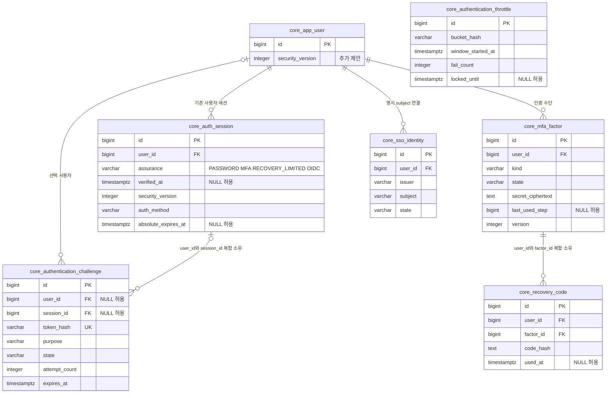
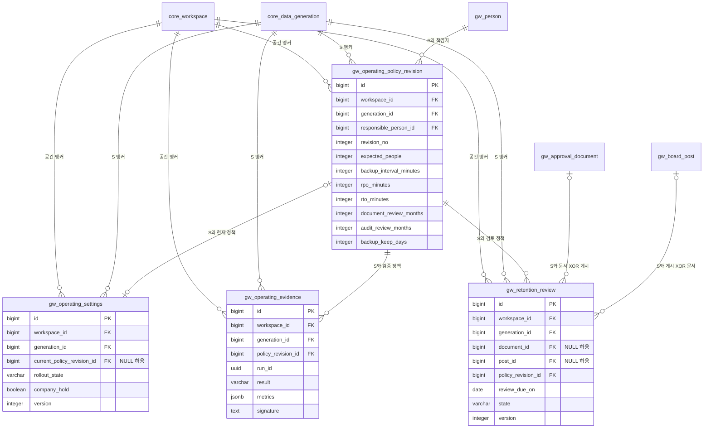

# GW-READY-01 제안 ERD

2026-10-18 · **제품 DB에 미적용**. 기존210표의 ERD와 분리한 검토용이다. 신규9표·기존2표 확장·제안FK19개다. 컬럼/NULL/기본값/상태/부분유니크/서비스 정책은 [상세 계약](../보안운영_DB_API_GW-READY-01.md), [검토 Excel](GW-READY-01_제안DB.xlsx), [기계 판독 제안](schema-proposal.json)을 함께 본다. diagram의 식별자는 `.`을 `_`로 표기했다.

## 인증 소유: core

`authentication_throttle`은 HMAC 버킷을 사용해 사용자 존재 여부와 무관하게 제한하며 core/GW 업무 표로의 FK는 없다. 기존 auth_session 사용자 FK를 제외한 제안 FK는5개다. subject나 인증 수단을 GW 직원으로 직접 FK 연결하지 않는다.

## 업무 소유: GW

GW 제안 FK14개는 core의 공간/세대 앵커8개와 GW 내부6개다. 모든 GW 내부 참조는 S 복합키이고 삭제/변경 RESTRICT다. `retention_review`는 document/post 중 정확히1개를 참조한다. 사용자별 보안 주체 식별자는 감사 값으로 검증/보관하되 core로 업무 FK를 추가하지 않는다.
