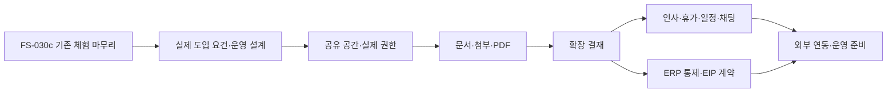

# GW-EXT-01 — GW 제외 범위 확장 결정 초안

> **2026-10-05 D81(ROADMAP-02, DSN-90 7-1) 개정:** 사원·부서·발령·근태·휴가의 원천은 **HR(DSN-30)**이다. §3 "인사·근태·휴가", GX-06, §8 인사 기초·근태·휴가는 HR로 옮기고, GW 조직·소속(§5 `organization_unit`·`person_assignment`)은 HR `departments()`·`employees()`를 가져온 스냅샷으로 한다. GW는 일정·채팅, 계정 ↔ 직원 연결·문서 권한을 맡는다.

작성 2026-10-05 · 상태 **범위·단계 순서 승인(2026-10-05 사용자 “상세 설계 진행해줘”), 구현 미착수**.
기준: `codex/fs-030-gw` / `1f96532`, FS-030b 완료·c 미착수. 원격 최신 상태를 이번에 다시 조회하지 않았으며 구현 전 최신 main과 조율한다.
요청: 기존 FS-030 결정서 §7의 제외 항목을 구현 가능한 확장 계획으로 전환한다.

## 1. 기획 의도 검토

개인 역할 체험형 GW에서 실제 로그인 계정 여러 명이 함께 기안·결재·협업할 수 있는 구조로 확장한다. 게스트 체험은 유지한다. 사용자가 **“실제 회사 도입까지 목표”**라고 확정했다(2026-10-05). 전시용 합성 공간은 유지하고 실운영은 분리된 환경에서 준비한다. 회사 규모·배포 환경·운영 책임자·외부 공급자는 아직 정해지지 않았다. 기존 “운영 전환 없음/실제 데이터 없음” 결정은 이 목표와 충돌하므로 본 초안 승인 시 개발 목표를 개정하되, 지금 공개 전시 환경에 실데이터를 허용하는 것으로 해석하지 않는다.

이번 산출물은 범위·소유권·선행 조건·상태 흐름·수용 조건을 정하는 결정 초안이다. 전체 DB/API/화면 설계 승인을 대신하지 않는다. 제품 코드·schema.json·Excel·ERD·마이그레이션·운영 설정은 변경하지 않는다.

참조: [원 결정 D60~69](GW도입_전자결재_결정_FS-030.md), [GW 모듈](../modules/gw/GW_모듈설계_FS-030.md), [FS-013 경계](독립솔루션_전환결정_FS-013.md), [로드맵](로드맵_17개시스템_ROADMAP-01.md), [b 검증](../agent/GW_API화면_FS-030b.md).

## 2. 예상 문제점·제약과 코드 근거

| 확인한 현재 구조 | 필요한 변경 |
|---|---|
| `common/auth.py::_resolve_member`, `core/service.py` 로그인은 workspace.owner_user_id와 MEMBER 공간으로 조인 | 계정과 활성 공간을 분리하고 공유 공간 멤버십을 검증. 로그인 SQL만 고치면 다른 API에서 권한이 샐 수 있으므로 공통 인증/스코프 전체 회귀 필요 |
| `common/scope.py`는 활성 세대·만료·모듈 상태 재검사, 다중 멤버 권한은 없음 | 모든 요청에서 멤버십·모듈 접근을 재검사하고 쓰기는 공간 잠금 후 권한 재검사. 권한 회수/공간 초기화와 직렬화 |
| D61 actingPersonId는 합성 역할 선택이며 계정 권한이 아님 | 공유 공간에서는 서버 인증 주체→직원 바인딩으로 결정. 클라이언트 임의 역할 선택 금지 |
| GW 조회가 같은 공간 전체 문서를 보여 주는 체험 구조 | 문서/글/첨부/검색/대시보드/ERP 배지/내보내기에도 객체 권한 적용 |
| D63 순차 1~3단계와 고정 상신본 | 순차·병렬·합의 정책을 버전으로 저장. 기존 문서는 v1 그대로 조회/처리 |
| D67 게시 후 본문 불변 | 댓글·첨부·편집기도 게시/상신된 버전을 덮어쓰지 않도록 설계 |
| D65 ERP 승인 통제 없음, FS-013 교차 쓰기 금지 | ERP가 GW 승인 근거를 조회하고 자기 확정 명령 안에서 통제. GW가 ERP 테이블을 쓰지 않음 |
| 개인 공간 초기화·시드 복사는 실제 사용자 협업을 고려하지 않음 | 멤버십/초대/실제 감사/메시지/파일을 게스트 템플릿에 복사하지 않음. 공유 공간은 일반 체험 초기화 금지 |

공유 공간은 GW만의 기능이 아니다. **초기 공유 공간에서는 GW만 허용**하고, ERP 연결은 해당 단계에서 ERP의 행위 권한을 갖춘 뒤 활성화한다. 기존 개인/게스트 공간의 모든 앱은 유지한다. 미검증 앱 API는 공유 공간에서 공통 스코프로 차단한다.

## 3. 제외 항목 전수 대응

| 기존 제외 항목 | 확장 설계·소유자 | 순서 |
|---|---|---|
| 실제 직원 계정·조직도·공유 공간·초대 | core 계정/공간/멤버십, GW 조직/직원/업무 역할. 로그인 계정과 직원 레코드는 분리 | A |
| 인사·근태·휴가 | GW 인사 기초(직원/소속/재직)·근태 사건·휴가 원장. 급여·법정 계산은 별도 요구 분석 | D |
| 법적 전자서명·인증서 | 서명 공급자 어댑터·요청/수신/검증/증빙 보관. 외부 계약·인증 방식 결정 후 구현 | F |
| 문서 위변조 방지 보증 | 해시·불변 버전·외부 보관 증거로 변조 탐지 설계. DB 관리자까지 포함한 절대 보증은 기능명으로 약속하지 않음 | B/F |
| ERP 확정 통제·교차 쓰기 | ERP 소유 확정 정책·승인 증빙 소비. 기능 목적은 달성하되 직접 교차 쓰기는 유지 금지 | E |
| 전사 대시보드·EIP 공지 집계 | EIP가 각 interface를 읽어 구성. GW는 공지 원본·노출 권한·요약 계약 제공 | E |
| 댓글·첨부 | 글/문서별 권한, 파일 격리/검사, 댓글 정정 이력 | B |
| 일정·채팅·메일·외부 알림 | 일정/참석, 채널/메시지, 외부 메일 연동, 발송 큐·실패 재처리 | D/F |
| 병렬 결재·합의·전결·위임 | 결재 정책 버전·단계 그룹·담당자별 처리·위임 유효 범위 | C |
| 반복 자동 결재 | 반복 기안 자동 생성부터, 승인 자동화는 별도 명시 규칙/한도·감사·중지 기능 | C 후반 |
| 문서 편집기·파일/PDF 출력 | 구조화 문서·템플릿 버전·제한된 서식·고정 상신본/PDF | B |
| 실제 회사 데이터 | 전시 합성 공간과 실운영 환경 분리·보관/삭제/복구/접근 설계를 P0에서 확정, 시범 운영 준비 완료 후 반입 | P0/도입 |
| push·배포 | 릴리스 점검·백업·복구·배포 절차 설계. 이 요청으로 실제 실행하지 않음 | 최종 인계 |

## 4. 결정 제안 (로컬 식별자 GX-01~10)

다른 작업자의 D/AC 번호와 충돌하지 않도록 공식 번호를 선점하지 않는다. 승인 후 최신 main에서 작업 ID·D·AC·화면 번호를 배정한다.

| 제안 | 내용 | 개정 대상 |
|---|---|---|
| GX-01 | PERSONAL/GUEST 체험 유지 + 별도 TEAM 공유 공간, 공간 생성 시 모드 고정. 체험 공간을 실제 협업 공간으로 직접 승격하지 않음 | FS-013 개인 공간 전제, D61·68 |
| GX-02 | core 멤버십과 GW 업무 권한 분리. 실제 계정은 기존 core 인증 사용, 비밀번호/세션을 GW에 복제하지 않음 | D60·61 |
| GX-03 | 초대 수락·정지·탈퇴·권한 회수·최종 소유자 보호, 직원 비활성화 시 진행 결재를 관리자가 사유 있는 재배정 사건으로 처리 | D61·64 |
| GX-04 | 문서 ACL·댓글·첨부·편집/출력 도입. 상신/게시 본문 및 파일 manifest는 불변, 정정은 새 버전/새 회차 | D62·64·67 |
| GX-05 | 결재 정책 v2: 순차/병렬/합의/전결/위임, 기존 v1 보존. 반복 생성과 자동 승인을 명확히 구분 | D63·64 |
| GX-06 | 인사 기초·근태·휴가·일정·채팅은 별도 GW 하위 도메인으로 관리. 임의 급여 계산/생체 인증은 포함하지 않음 | D60·67 |
| GX-07 | ERP 확정 통제는 선택 정책으로 ERP가 소유. 기본 OFF, 승인된 새 문서/적용일 이후만 사용, 과거 확정본 소급 차단 없음 | D65·66 |
| GX-08 | EIP가 전사 집계 소유, GW는 권한 필터된 공지/업무 집계 읽기 계약. core에 업무 대시보드 저장 안 함 | D60, 로드맵 §6-3 유지 |
| GX-09 | 내부 알림→외부 메일/알림→서명 공급자 순서. 공급자 연결 전에는 명시된 모의 어댑터만 사용 | D67 |
| GX-10 | 실제 회사 도입 목표 확정. 공개 전시와 운영 환경/DB/저장소/인증 설정을 분리, P0에서 운영 요건부터 확정. FS-030c는 기존 범위로 먼저 닫고 확장은 단계별 설계/검증 | D68·69, §7, 기존 운영 전환 없음 결정 |

## 4-1. P0 — 실제 도입 전제와 운영 설계 (A 상세 설계보다 먼저)

첫 도입은 **한 회사의 제한된 부서·문서 유형**으로 시범 운영하는 방식을 제안한다. 다회사 SaaS 운영·24시간 가용성·처리량을 검증 없이 약속하지 않는다. 도입 대상이 정해지면 아래 표의 미정 값을 실제 요구사항으로 채운다.

| 확정할 값 | 이번 설계 방향 | 확정 주체/근거 |
|---|---|---|
| 사용자 수·동시 접속·월 문서/파일량 | 미정. 회사/부서/최대 파일 크기와 1년 증가량을 받아 용량·부하 시험 설계 | 도입 담당자 |
| 배포/접속 | 단일 회사 전용 환경을 우선 제안. 클라우드/사내망·허용 기기·외부 접근·접근 도메인 미정 | 회사 IT 담당 |
| 인증 | 기존 인증 연장과 회사 SSO 연동 비교. 운영 관리자 MFA·세션 회수·안전한 계정 복구·로그인 제한을 출시 조건으로 설계 | 회사 인증 정책 |
| 백업/복구 | DB+파일+설정/키 참조를 일관 복원. RPO/RTO 숫자는 임의 확정하지 않고 회사 허용 손실·중단시간을 받아 목표 설정 | 업무 책임자/운영자 |
| 개인정보·보존 | 필드별 수집 목적/권한/보존/삭제·퇴사자 처리·증빙 보존 충돌 정책 결정. 법정 기간은 추정하지 않음 | 회사 개인정보/법무 담당 |
| 지원·장애 대응 | 운영 책임자·연락 수단·장애 등급·복구 승인자·배포 가능 시간 확정 | 회사/유지보수 담당 |
| 외부 공급자 | 메일·파일 검사·SSO·전자서명 공급자와 비용/계약/장애 정책 미정 | 회사 구매/IT/법무 |

보안 설계는 요청 인증·CSRF·객체 ACL·민감 정보 마스킹·전송/저장 암호화와 키 관리·비밀 관리·취약점 점검·업로드 검사·관리자 감사까지 포함한다. 기능 구현과 별개로 도입 전 검증할 항목이며 현재 구현 완료로 표기하지 않는다.

**공유 TEAM 공간에는 새 환경 모드를 고정**한다. 체험의 합성 역할 전환·초기화·시드 생성·게스트 복사 API를 실제 운영 공간에서 서버가 차단한다. 공개 전시와 실운영은 단순 workspace_id 분리만으로 운영하지 않는다. 실제 도입 데이터의 파일/DB/백업·전송 계정도 분리한다.

### 실제 사용 개시 조건

- 운영자/복구 담당자·보존 정책·RPO/RTO·권한표가 확정되고 감사 가능한 형태로 기록되어 있다.
- 실제 계정 두 명 이상으로 기안→승인→퇴사/회수→접근 차단을 검증한다. 클라이언트 역할 선택 우회와 관리자 과권한을 검사한다.
- 백업에서 새 환경으로 DB·첨부·증빙을 복구해 문서/해시/권한을 대조하고 소요 시간·누락 범위를 측정한다. 백업 파일 존재만으로 통과하지 않는다.
- 합의한 동시 사용자/문서/파일 규모로 부하·재시도·장애 복구 검사를 통과한다. 한도를 초과하면 명시적으로 제한하고 데이터를 잃지 않는다.
- 시범 부서의 대표 문서로 업무 인수 확인을 받고, 기존 업무와 병행 검증 후 전환한다. 장애 때 대체 업무·복귀 방법을 정한다.
- 전자서명/법정 계산처럼 회사 외부 요건이 있는 기능은 검토 완료 전 해당 효력을 표방하거나 필수 업무의 근거로 사용하지 않는다.

메일·채팅·인사 전체가 완성되어야 기초 결재를 도입할 필요는 없다. **P0+A+B+C와 필요한 ERP 통제만 갖춘 제한 시범 운영**이 가능하도록 기능별 활성화와 인수 범위를 구분한다. D/F는 도입 우선순위에 따라 후속 활성화하되, 인증·백업·보안·운영 준비를 후속으로 미루지 않는다.

## 5. A — 공유 공간·계정·조직·권한 (첫 구현 후보)

### 소유권과 후보 엔티티

- core: 기존 app_user/auth_session/workspace 재사용, 후보 workspace_membership·workspace_invitation. 계정/공간 접근만 소유한다. 초대 token은 해시만 저장, 1회·만료·철회·재발급을 구분. 재발급하면 기존 token 무효.
- GW: 기존 person 확장, 후보 organization_unit·person_assignment·person_identity_binding·role_grant. 조직 순환 금지, 재직 종료 뒤 과거 결재 이름/소속 보존.
- 업무→core 사용자 FK는 추가하지 않는다. 서버가 검증한 불변 subject 문자열 바인딩을 저장하고 membership 조회 서비스로 활성 여부 확인. 같은 S·subject와 같은 S·person 바인딩 각각 유일. 퇴사 뒤 계정을 재사용해 과거 행위를 다른 사람에게 귀속시키지 않는다.
- 업무 FK는 `(workspace_id,generation_id,id)` + RESTRICT. core 멤버십은 세대 복사 대상이 아니다. 업무 직원 바인딩 재구성 없는 공유 공간 세대 전환은 차단한다.

### 권한과 상태

| 주체 | 허용 | 금지 |
|---|---|---|
| 공간 OWNER/ADMIN | 초대·멤버십 관리·모듈 설정 | 다른 직원 명의 결재, 본문 전체 자동 열람 |
| GW 조직 관리자 | 직원·조직·업무 역할 지정 | 자기 결재 대리 수행, 실제 인증 주체 변경 |
| 직원 | 자기 기안, 배정 결재, 허용 글·일정 | 임의 actingPersonId, 다른 부서 비공개 문서 |
| 감사 열람자 | 명시적으로 허용된 문서·이력 읽기 | 승인/수정·권한 부여 |
| 게스트 | 기존 합성 역할 체험 | 팀 공간 가입·초대·외부 발송 |

관리자 권한도 본문 ACL을 우회하지 않는다. 계정-직원 바인딩 변경은 강화된 인증·사유·감사 기록을 요구하고 기존 승인을 바꾸지 않는다. 조직 이동은 현재 접근권에 반영하지만 상신 당시 소속은 고정한다.

공간 선택 API가 임의 workspaceId를 신뢰하지 않고 활성 멤버십을 확인한다. 세션에 공간 선택을 저장하고 전환 시 클라이언트 쿼리·역할 캐시 폐기. 멤버십 회수와 결재 경합은 같은 공간 잠금으로 순서를 정한다. 회수가 먼저 commit되면 후속 결재는 거부한다. 이미 완료된 감사 주체는 유지한다.

초대: CREATED → ACCEPTED / REVOKED / EXPIRED, 수락은 기존 로그인 계정·대상 일치·만료를 서버에서 확인. 기본은 로그인 ID에 묶인 초대 링크를 관리자가 전달하는 방식이며, 이메일 전송은 F 단계에서 연결한다. 마지막 OWNER 제거 금지; 탈퇴 시 미결 결재 재배정/보류 정책 적용.

## 6. B — 문서·파일·댓글·출력

후보: document_revision, attachment, attachment_link, comment, comment_revision, export_job. 기존 approval_document/board_post와 연결하며 원문 구조를 일괄 덮어쓰지 않는다.

- 편집기는 허용된 문단/표/목록 구조를 저장하고 서버 검증. 임의 HTML/script·외부 이미지 자동 요청 금지. v1 plain text는 그대로 표시, v2 초안으로 복제해 편집 가능.
- 업로드는 UPLOADING → QUARANTINED → READY / REJECTED. 제안 기본 한도 파일10MB·문서10개, 초기 PDF/PNG/JPEG/TXT만 허용. MIME/실제 형식·바이러스 검사·용량 검사, READY만 연결/다운로드. 검사기 장애 시 승인하지 않는다.
- 파일은 비공개 저장소의 난수 키, 원래 파일명과 경로 분리. 서버가 문서 ACL 확인 후 짧은 다운로드 권한 발급. 공개 URL·경로 traversal·다른 공간 객체 연결 금지.
- 상신본에 본문 revision + 파일 ID/크기/hash manifest 고정. 연결 파일 교체 금지. 공유 파일 중복 저장을 줄이더라도 다른 공간 존재 여부를 응답으로 노출하지 않는다.
- 댓글 추가는 원문 승인 범위를 바꾸지 않는다. 수정은 revision, 삭제는 삭제 표시와 감사. 결재 승인/반려 사유는 별도 불변 사건 유지.
- PDF는 고정 revision에서 서버 렌더링, 폰트/표/페이지나눔 검증. 외부 네트워크 접근 차단, 작업 시간/메모리 한도. 출력물에 문서/회차·승인 상태·출력 시각·해시·체험 여부 표시. 출력물 자체가 인증서 서명이라고 표시하지 않는다.
- 파일 업로드 완료 전 DB 실패는 고아 객체 정리, DB 삭제/만료 후 저장소 정리는 재시도 큐로 처리. 참조 중이거나 보존 대상인 파일은 지우지 않는다.

## 7. C — 결재 정책 v2

후보: route_version, stage, participant, decision_event, delegation, authority_rule, recurring_rule, recurring_run. 기존 approval_event를 유지하고 v2 엔진은 계약 버전으로 분기한다.

- 순차는 이전 그룹 완료 후 다음 그룹 활성. 병렬은 그룹 내 모든 필수 승인 완료 시 진행, 한 명 반려하면 문서 종결·나머지는 SKIPPED. 임의 과반 정책은 초기에 넣지 않는다.
- 합의는 필수/참고를 상신 시 고정. 필수 합의 반대는 반려, 참고 의견은 승인 조건에 포함하지 않는다. 종료 시 미응답 참고 의견은 SKIPPED.
- 전결은 문서 유형·금액·통화·조직·유효기간별 권한 규칙을 상신 때 복사해 경로 확정. 적용 규칙과 생략 단계 사유를 기록. 이종 통화 자동 비교 금지, 해당 규칙 없으면 수동 경로로 진행.
- 위임은 시작/종료 실제 시각·대상 유형·금액 한도·수임자 지정. 연쇄 위임/자기 결재/기안자 우회 금지. 원 담당자와 실제 수행자 모두 사건에 저장. 유효성은 DB 시각으로 처리 순간 재검사, 회수와 결재는 직렬화.
- 진행 중 결재선 편집 금지. 퇴사/장기 부재는 원 단계/처리 이력을 남기는 관리 재배정 사건으로 처리하며 이미 승인된 단계를 재작성하지 않는다.
- 반복 일정은 시간대 + 실행 회차 키 유일성으로 초안을 한 번 생성. 재시작 후 밀린 회차는 기본 최신1건만 만들고 누락 회차를 기록. 자동 상신/승인은 별도 활성화 정책.
- 자동 승인은 허용 유형·상한·유효기간·규칙 버전·일일 건수 한도·비상 중지가 있는 서비스 행위로 기록. 실제 직원의 서명을 생성하지 않는다. ERP 확정/법적 서명/민감 휴가는 초기 자동 승인 대상에서 제외.
- 모든 명령에 version·멱등키, 경합 시 최종 전이/알림 생성은 1회. 입력400, 상태409, 멱등 충돌422 규약 유지.

## 8. D — 인사 기초·근태·휴가·일정·채팅

| 하위 영역 | 설계 핵심 | 검증할 사례 |
|---|---|---|
| 인사 기초 | 직원·부서·직책·재직 기간, 상세 인사정보는 HR 역할만. 법정 식별번호/급여/건강정보는 초기 수집 안 함 | 일반 직원이 인사 상세/검색/출력으로 우회 열람 불가 |
| 근태 | 출퇴근 사건 추가 전용, 정정 신청과 승인 기록 분리, 서버 수신 시각과 신고 업무시각 구분 | 야간 교대·자정 넘김·중복 출근·퇴근 누락·정정 이력 |
| 휴가 | 부여/예약/사용/반환 원장, 단위는 정수 분, 신청 중 잔여 예약→승인 시 사용→반려/회수 시 반환 | 동시 신청 잔여 초과 방지, 반일/시간 휴가, 취소 1회 반환 |
| 일정 | 업무 시간대·참석자·반복 규칙·개별 예외, 개인/조직 공개 범위 | 반복 일정 일부 취소, 권한 없는 일정 제목 숨김 |
| 채팅 | 채널 멤버십·추가 전용 메시지/정정·읽음 커서, 재연결 순번·중복 제거 | 탈퇴 후 수신 차단, 외부 공간 채널ID 접근 거부 |

휴가 부여/공휴일/근무 기준은 관리자가 설정하는 규칙 버전이며 법정 계산의 정확성을 주장하지 않는다. 실제 도입 시 적용 규정 검토 후 별도 확정한다. 채팅은 기존 HTTP 저장을 먼저 구현하고 실시간 전송 수단은 부하/연결 요건 검토 후 선택한다.

## 9. E — ERP 통제와 EIP 집계

**교차 쓰기는 도입하지 않는다.** ERP 확정 명령이 자기 문서를 잠그고, GW 읽기 interface로 승인 증빙을 받아 일치 여부를 검사한 뒤 ERP 상태/증빙을 같은 ERP 트랜잭션에 저장한다.

- ERP 문서 종류별 정책 OFF/REQUIRED. REQUIRED에서 미승인/진행/반려/원천 변경/조회 장애면 확정 거부. UI 버튼뿐 아니라 API/배치 등 모든 확정 경로에 적용. ERP 원문 변경과 확정도 같은 ERP 잠금을 사용.
- 확정 증빙: GW 문서번호·회차·최종 사건 순번·원천 고유 코드·승인 digest·정책 버전. 승인된 문서는 불변으로 유지하며 승인 취소는 초기 미지원. 미래 취소 지원 시 거래 보상 정책을 먼저 결정.
- 기존 v1 digest는 날짜/상태를 제외한다. 지급일 등 통제 대상이 늘면 **ERP approval digest v2**를 별도 정의하고 버전을 기록. v1 사후 검토 승인으로 v2 확정 통제를 통과시키지 않는다.
- ERP 문서 번호 재사용에 대비해 불변 원천 참조 코드/개정 번호를 ERP가 제공해야 한다. 업무 FK/내부 ID 공유 없이 식별하며, 공유 공간 ERP 권한 도입이 선행 조건이다.
- ERP REQUIRED 정책에서 GW off 시 우회 허용하지 않는다. 장애 시 재시도 안내, 정책 변경은 권한·사유·감사 대상. 과거 확정 자료를 되돌리지 않는다.
- EIP는 GW가 반환하는 현재 사용자에게 허용된 공지/결재 요약을 읽는다. 캐시 키에 S·subject·권한 버전 포함. 모듈 off/조회 실패를 0건과 구분. EIP에서 글 수정/결재를 직접 수행하지 않고 GW로 이동한다.

## 10. F — 메일·외부 알림·서명·실운영 준비

- 내부 알림은 업무 변경 TX 안에 outbox 기록, worker가 전달. 중복 키=(공간,사건,수신자,채널), 재시도/backoff·최대 횟수·실패함·관리자 재시도. 외부 서비스가 멱등을 지원하지 않으면 전달 중복 가능성을 명시하고 성공을 추측하지 않는다.
- 메일은 전체 메일 서버 구축 대신 기존 공급자 송수신 어댑터를 제안. 사용자 인증/연결 해제·최소 권한·계정별 데이터 접근·첨부 검사·외부 수신자 확인. 비밀 토큰은 환경의 비밀 저장소, DB에는 참조만. 공급자/비용/도메인은 미정.
- 서명 흐름: 고정 문서 hash → 공급자 요청 → 서명 대기 → 검증된 결과 수신 → 증빙 보관. webhook 인증·재전송/순서 뒤집힘·문서 hash 불일치·취소/실패·인증서 상태 확인 계약 포함. 화면 결재 도장 이미지와 외부 전자서명 완료를 구분한다.
- 해시/감사 로그는 변경 탐지 수단이며 동일 DB 관리자에 대한 불변 보증이 아니다. 별도 보관소의 보존 잠금/독립 감사 사본·검증 절차를 선택해야 보장 범위를 높일 수 있다. 법적 효력은 관할·서명 방식·계약에 따른 별도 검토 사항이며 본 문서에서 보증하지 않는다.
- 실제 회사 데이터 도입은 전시와 별도 환경·저장소·접근 정책, 백업/복구 실측, 보존·삭제·내보내기, 사고 대응·관리자 감사·계정 복구·강화 인증 요건부터 확정한다. 실데이터를 시드/공개 저장소/게스트 체험에 복사하지 않는다.
- 배포는 기능 설계와 별개 승인 절차: 백업→새 migration→검증→애플리케이션 반영→스모크→문제 시 코드/데이터 복구 판단. 적용 migration 수정 금지, 운영 DB 되돌리기를 자동 실행하지 않는다.

## 11. 개발 순서와 단계 완료 조건

의존 관계도이며 여러 단계 동시 착수를 뜻하지 않는다. 기본 실행 순서는 c→P0→A→B→C→D→E→F이며, 회사가 ERP 통제를 시범 운영 필수로 정하면 E의 ERP 부분을 D보다 먼저 진행한다. 각 단계 결정 확정→모듈/화면 전체 설계→DB→API/UI→시드/도움말/통합→보고 확인을 따른다.

- A 우선 상세 설계: core 공통 영향 목록·인증/공간 전환 API·GW ACL·초대/탈퇴·직원 조직·권한 화면. 기존 G01~07은 유지, 추가 화면 번호는 충돌 확인 후 확정.
- B 이후 각 단계: 엔티티/컬럼/인덱스/보존·정리·API 요청/응답/에러·잠금 순서·화면 상태/접근성까지 확정 후 코드 작성. 위 후보 테이블명은 schema.json 반영 지시가 아니다.
- 기존 개인 공간/게스트/v1 결재를 자동 TEAM/v2로 바꾸지 않는다. 전환은 명시적 신규 생성. 기존 마이그레이션 수정 없이 새 revision, DB 변경 때 schema.json·Excel·ERD 동시 갱신.
- 테스트는 Codex 전용 DB/포트. 공유 권한이 없는 기존 솔루션 차단, 기존 개인/게스트 동작 회귀가 A 완료 필수 조건이다.

### 인수 시나리오 초안 (정식 AC 번호 미배정)

1. 실제 계정 A가 팀을 만들고 B를 초대하면 B만 수락 가능; 만료/재사용/철회 초대는 거부.
2. A 기안→B 로그인 승인, A가 B personId를 보내도 거부. 게스트의 팀 공간 접근 차단.
3. B 멤버십 회수가 먼저 완료된 경합에서 B의 후속 승인 실패; 기존 승인 이력은 보존.
4. 공간 소유자라도 허가 없는 본문·파일·검색·집계 열람 불가. 최종 소유자 제거 거부.
5. v1 결재 이력 불변, v2 병렬 마지막 동시 승인도 완료 사건1개; 위임 자기 결재 우회 거부.
6. 상신 후 본문/첨부 교체 불가, 오염/미검사 파일 차단, PDF 내용이 저장 revision과 일치.
7. 휴가 동시 신청이 잔여를 초과하지 않고 반려/취소를 재시도해도 반환1회.
8. 반복 실행/알림 worker 재시작에도 기안·내부 알림 중복0. 자동 승인에는 규칙 주체 표시.
9. ERP REQUIRED 정책에서 승인 digest/원천 개정 불일치·GW off면 확정 거부, ERP/GW 교차쓰기0.
10. EIP 집계/메일/채팅에서 다른 공간/비공개 내용 유출0, 권한 회수 뒤 새 전달 차단.
11. 서명 callback 위조/중복/hash 불일치로 완료 처리되지 않음. 모의 결과와 실제 공급자 결과 구분.
12. 실제 멤버십·초대·메일·파일·감사 기록이 게스트 복사에 포함되지 않음. 백업 복구는 별도 실측.

## 12. 질문과 권장안 — 확인할 결정

1. 목표는 **실제 회사 도입까지**로 사용자 확정. 아직 미정인 회사 규모·접속 환경·RPO/RTO·보존 정책은 P0에서 회사 요구사항으로 확정한다.
2. 위 전수 범위를 단계적으로 설계하되 **기존 c→P0 운영 설계→A 공유 공간/권한부터** 진행할지? 권장: 이 순서. 기존 도움말/체험 완료 없이 확장을 계속 쌓지 않는다.
3. ERP는 자기 확정 통제, EIP는 전사 집계, 교차 쓰기 금지 유지에 동의하는가? 권장: 유지. 사용자가 원하는 업무 연결은 이 구조로 구현 가능하다.
4. 외부 공급자 미선정 상태에서는 모의 어댑터 계약만 설계하고 메일 발송·서명 계약·실데이터 반입·push/배포는 별도 실행 확인으로 둘지? 권장: 분리.

2026-10-05 사용자 “상세 설계 진행해줘”로 위 범위·단계 순서를 승인한 것으로 기록한다. A의 전체 모듈/화면 상세 설계가 확인되기 전 제품 코드/DB 변경은 시작하지 않는다. 기존 D60~69는 FS-030 개인/게스트 구현의 기준으로 유지하고, 공유 공간은 별도 확장 계약으로 개정한다.

[P0/A 상세 설계 묶음](GW확장_상세설계검증_GW-EXT-A.md)을 작성했다. 회사 운영 요구값과 MFA/복구 부속설계가 아직 미정이며 실제 운영 승인과 구분한다.

## 13. 이번 검증·미실행

현재 문서·core 인증/스코프·GW 계약을 읽고 범위 누락/경계 충돌을 검토했다. 상대 링크·제안 식별자·필수 범위·현황200줄·git diff 공백을 정적 검사한다. 제품 변경이 없어 pytest/Vitest/브라우저/DB 적용·시드·외부 공급자·격리 감사를 실행하지 않는다. 과거 b 테스트 수를 이번 확장 통과로 표시하지 않는다.
