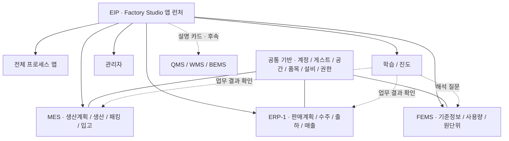
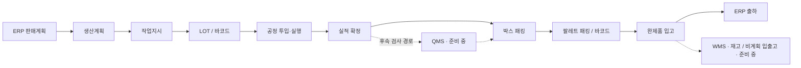
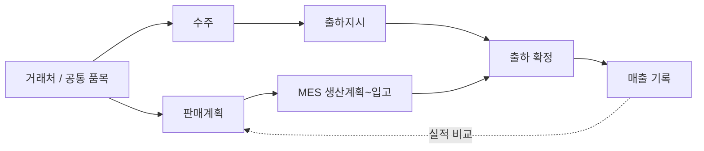
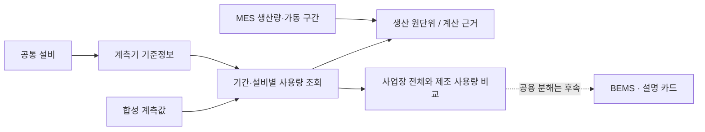

# 설계 완료·사용자 확인 기준 및 시각화 구성

작성: 2026-09-20. 사용자 최신 지침. 기존 ‘S0 종료 → FS-009 즉시 착수’ 안내보다 우선한다.
현재 상태: 설계 보완 중. 제품 개발 착수 승인 전.

## 1. 설계 후 개발 원칙

아키텍처, DB 명세서, 개발 방식, 업무 흐름과 화면 설계를 먼저 완료한다. 사용자가 전체 설계를 보고 의도와 일치하는지 확인한 후 제품 개발을 시작한다. 개별 설계 작업의 확인을 전체 개발 착수 승인으로 해석하지 않는다.

설계 기간에는 문서, ERD/업무 다이어그램, Excel 설계서, 검토용 UI 시제품을 작성·검증할 수 있다. 제품 코드·실제 DB 생성/변경·migration 적용·운영 배포는 설계 확인 전에 시작하지 않는다. 문서 생성 도구/정적 검증은 제품 기능 구현과 구별한다.

승인 대상은 현재 첫 공개 범위(MES/FEMS/ERP-1 + 공통/학습/맵/관리자) 전체다. 후속 QMS/WMS/BEMS의 상세 구현까지 모두 설계해야 한다는 뜻은 아니며, 현재와 연결되는 경계와 준비 중 상태는 정의한다. 승인 후 범위/데이터 책임/업무 규칙이 크게 바뀌면 해당 설계를 먼저 갱신해 확인받고 영향을 받는 개발을 진행한다.

## 2. 사용자가 확인할 설계 묶음

| 묶음 | 필수 산출물 | 확인 내용 |
|---|---|---|
| 제품·업무 | 전체 프로세스, 모듈별 업무 카드, 포함/제외·예외 | 원하는 업무가 빠짐없이 표현됐는가 |
| 아키텍처 | EIP 구성도, 모듈 책임, 서비스/API 경계, 인증·게스트·데이터 흐름 | 어디서 처리하고 무엇을 공유하는가 |
| DB | 전체 및 모듈별 ERD, 모듈별 Excel, 상태·수량·참조 제약 | 실제 업무를 저장·추적할 수 있는가 |
| 개발 방식 | 디렉터리/계층, 버전, API 계약, 트랜잭션, migration/seed/테스트·문서 갱신 | 어떤 규칙으로 구현·검증하는가 |
| UI·학습 | 앱 홈, 모듈 업무 지도, 목록/상세/입력/결과, 학습 도움말·이어하기 | 화면 진입과 사용 흐름이 의도에 맞는가 |
| 일정·완료 조건 | 작업 ID, 선행 조건, 산출물, 검증, 미확정 결정 | 설계와 개발을 구분하고 다음 작업이 명확한가 |

게스트 주체/삭제/복사, 계획→지시 연결, 패킹·출하 대사 등 재검토 지적은 이 묶음에서 해소한다. 모든 필수 항목이 준비되고 사용자 확인을 받기 전에는 FS-009 제품 개발을 시작하지 않는다.

## 3. Excel의 모듈별 구분 — 다음 DB 문서 개정의 사양

한 파일 `docs/db/DB설계서.xlsx` 안에서 시트를 모듈별로 묶는다. Excel은 실제 시트 폴더 대신 접두어·목차 링크·탭 색상을 사용한다.

- `00_목차`, `00_전체관계`, `00_변경이력`: 전체 탐색, 모듈 간 참조, 적용/검증 상태.
- `CORE_테이블`, `CORE_컬럼`, `CORE_관계`, `CORE_규칙`.
- `MES_테이블`, `MES_컬럼`, `MES_관계`, `MES_규칙`.
- `ERP_테이블`, `ERP_컬럼`, `ERP_관계`, `ERP_규칙`.
- `FEMS_테이블`, `FEMS_컬럼`, `FEMS_관계`, `FEMS_규칙`.
- `LEARN_*`, `MAP_*`: 학습 및 프로세스 맵 콘텐츠를 같은 구조로 구분한다.
- `BEMS_*`: 현재 메타데이터의 예약 설계는 유지하되 ‘후속·미구현’으로 표시한다. QMS/WMS는 실제 정의가 생길 때 추가하며 빈 테이블 명세를 만들지 않는다.

‘규칙’에는 제약/인덱스/상태/보존·초기화 및 서비스 정책을 구분해서 싣는다. 컬럼에는 타입·NULL·기본값·PK/FK·설명을 포함한다. 다른 모듈 FK는 대상 모듈/테이블을 명시하고 이동 링크를 제공한다. 각 모듈에서 전체 목차로 돌아갈 수 있어야 한다.

공유 테이블은 소유 모듈에 한 번만 정의한다. 예를 들어 core.item을 ERP/MES가 참조해도 명세를 복제하지 않는다. 모든 시트와 ERD는 같은 메타데이터를 사용해 이름·키·관계·버전이 어긋나지 않게 한다. DB 미적용/정적 검증/실제 검증 상태를 구별한다.

이번 작업에서는 구성 지침만 확정했으며 기존 Excel은 아직 이 구조로 재생성하지 않았다.

## 4. 시각화는 세 층으로 제공

1. **EIP 전체 구성도**: 어떤 모듈이 있고 누가 무엇을 소유하는지.
2. **MES/FEMS/ERP 업무 흐름도**: 어떤 순서로 처리하고 입력·결과가 어디로 전달되는지.
3. **전체 및 모듈별 ERD**: 실제 테이블, PK/FK, 1:N/선택 관계, 공간·세대 범위.

업무 흐름 화살표와 DB FK를 같은 의미로 표시하지 않는다. 아래는 개념 흐름 초안이며 확정 ERD가 아니다. 실제 테이블/키/카디널리티 다이어그램은 설계 보완 후 별도 산출물로 제공한다. 최종 열람본은 확대 가능한 HTML/SVG 등과 원본 Mermaid를 함께 보관하고 모듈별로 나눠 읽을 수 있게 한다.

### EIP 전체 구성 — 개념도

### MES 업무 — 개념도

### ERP-1 업무 — 개념도

수주와 생산은 MTS에서 별도 흐름으로 놓는다. 위 도식은 수주가 반드시 입고 후에만 가능하다는 제약을 뜻하지 않는다. 출하 시 입고된 물량을 대사한다.

### FEMS 업무 — 개념도

수집 파이프라인·실설비 연동은 현재 범위가 아니다. 요금제·배출계수 등 미확정 기능은 확정 기능처럼 도식에 추가하지 않는다.

## 5. UI 시각 기준

사용자가 수정한 UI와 첨부 화면을 시각 기준으로 삼는다.

| 요소 | 기준 |
|---|---|
| 배경 | 백자 `#F7F7F6` |
| 기본 텍스트 | 먹색 `#1A1C1E` |
| 주요 버튼·선택·포인트 | 쪽빛 `#1F2D3D` |
| 아이콘 | 모듈별 단색 SVG 라인 아이콘. 같은 굵기·크기 체계 |
| 그림자 | 최대 4% 불투명도 수준의 최소 표현 |
| 상태 배지 | 저채도 전통색 계열. 텍스트로 상태도 명시 |
| 구성 | 넓은 여백, 절제된 경계선, 짧은 모듈명, 단정한 카드 |

색상/간격/아이콘을 공통 디자인 토큰으로 정의한다. 작은 글씨·배지·비활성 상태의 대비와 키보드 포커스는 실제 화면에서 검증한다. 저채도가 낮은 가독성을 뜻하지 않도록 한다.

첨부 이미지의 SCM 아이콘은 색감/레이아웃 참고이며 기능 범위 추가로 해석하지 않는다. QMS/WMS는 준비 중, ERP-1은 구현 대상이라는 현재 기획을 유지한다. 화면의 이전 ‘가상 후공정 / 다이 접착’ 문구는 새 전자부품 양산 사례와 구분해 갱신한다. 사용자 수정 UI 파일은 이번에 덮어쓰지 않는다.

## 6. 다음 순서

설계 보완(FS-006b 제안) → DB/Excel·모듈 ERD(FS-007b 제안) → 전체 흐름/UI 설계 개정(FS-008a 제안) → 개발 방식·일정 정합화 → 전체 설계 사용자 확인 → FS-009 개발 착수.

각 작업별 결과 확인 원칙도 유지한다. 위 신규 ID는 작업 분할 제안이며 완료 상태가 아니다.
